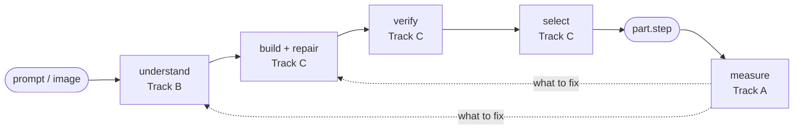

# forge — prompt or image to CAD, scored on geometry

Team repo for Sphere Forge #1 (Munich, 11–13 Nov 2026). An agent that writes a CAD
program, runs it, checks its own work and submits the part closest to a hidden target.



## Start here

| If you want to… | Read |
|---|---|
| understand how the agent works | [docs/ARCHITECTURE.md](docs/ARCHITECTURE.md) |
| know the plan, the split and the timeline | [docs/STRATEGY.md](docs/STRATEGY.md) |
| pick up your track | [A — Measure](docs/tracks/A-measure.md) · [B — Understand](docs/tracks/B-understand.md) · [C — Build](docs/tracks/C-build.md) |
| see target numbers | [docs/SCOREBOARD.md](docs/SCOREBOARD.md) |
| find open problems and vocabulary | [docs/RESEARCH.md](docs/RESEARCH.md) |
| brief your coding agent | [AGENTS.md](AGENTS.md) (Claude Code reads it via `CLAUDE.md`) |

## Setup

Needs [uv](https://docs.astral.sh/uv/). Python and all dependencies install themselves.

```bash
uv sync
```

```bash
uv run pytest -q
```

```bash
uv run python -m forge bench
```

For anything that calls a model:

```bash
export ANTHROPIC_API_KEY=...
```

```bash
uv run python -m forge solve "a 40 mm cube with a 10 mm hole through the top" -o runs/try
```

```bash
uv run python -m forge eval --tag a-baseline-text
```

## Status

- Offline tests pass. The pipeline has been exercised end to end with scripted model replies.
- **No real baseline yet.** The agent has not been run against a live model.
- CAD engine, models and the exact metric are placeholders until the briefing;
  [ARCHITECTURE.md](docs/ARCHITECTURE.md#what-gets-replaced-at-the-briefing) shows where each plugs in.

## Working agreement

`main` always works. Branch as `<track>/<idea>`, open a pull request, state the score
before and after. Stay inside your track's files. Details in [STRATEGY.md](docs/STRATEGY.md#how-we-work-in-the-repo).
