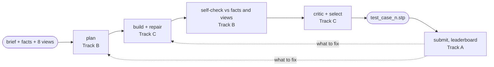

# forge — design brief and views to a STEP solid

Team repo for Sphere Forge #1 (Munich, 11–13 Nov 2026, code freeze Friday 08:00).
For each mechanical part we get a written brief with exact dimensions, a `facts.json`
with the target's measurements, and eight orthographic views. We return one STEP solid.



**Score:** `0.30 volume + 0.30 surface + 0.20 dimensions + 0.20 holes`, after rigid
alignment. Pose is free; size and handedness are not. A missing file scores 0.

## Start here

| If you want to… | Read |
|---|---|
| understand how the agent works | [docs/ARCHITECTURE.md](docs/ARCHITECTURE.md) |
| know the rules, the split, the timeline, and why we are not training a network | [docs/STRATEGY.md](docs/STRATEGY.md) |
| pick up your track | [A — Ship](docs/tracks/A-ship.md) · [B — See](docs/tracks/B-see.md) · [C — Build](docs/tracks/C-build.md) |
| see the scoring rule and target numbers | [docs/SCOREBOARD.md](docs/SCOREBOARD.md) |
| find open problems and vocabulary | [docs/RESEARCH.md](docs/RESEARCH.md) |
| brief your coding agent | [AGENTS.md](AGENTS.md) (Claude Code reads it via `CLAUDE.md`) |

## Setup

Needs [uv](https://docs.astral.sh/uv/).

```bash
uv sync
```

```bash
uv run pytest -q
```

To run the agent, point it at an OpenAI-compatible endpoint that accepts images:

```bash
export OPENAI_BASE_URL=http://localhost:8000/v1 OPENAI_API_KEY=... OPENAI_MODEL=...
```

```bash
uv run python scripts/main.py --input_dir artifacts/inputs --output_dir artifacts/outputs
```

`artifacts/inputs` is the organisers' practice set. Without a reachable model the run
still writes a bounding-box solid for every part.

## Submitting

This repo submits by itself; no second repo from the organisers' template is needed.
**Every push to `main` is a submission**: CI builds the image, pushes it to the
organisers' registry and uploads `artifacts/outputs/test_case_*.stp`
(`.ci/push.sh`, taken unchanged from their
[template](https://github.com/sphere-energy/hackathon-submission)).

- Regenerate and commit all nine outputs in the same change as the code that made them.
- A commit can be submitted once. To resubmit, push a new commit.
- The leaderboard keeps our best commit.
- The organisers' `*.env` credential files are ignored by git. Never commit them.

## Status

- Offline tests pass. The pipeline reads the organisers' nine practice parts and writes
  nine valid `.stp` files (fallback blocks) without a model. The Docker image builds and
  does the same as a non-root user (built on arm64; the `linux/amd64` build is untested).
- **Not yet run with a real model, and nothing submitted.** No leaderboard score exists.
- `artifacts/outputs/` holds nine bounding-box solids: a valid first submission that
  should score about 0.3.
