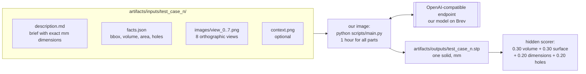
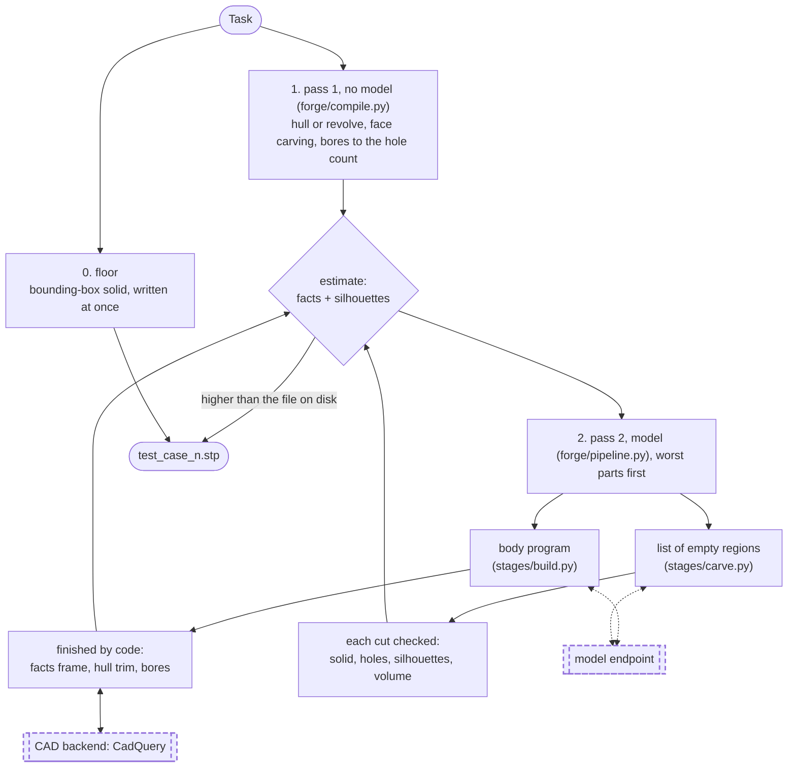

# Architecture

How the agent works after the kickoff rules. Read this first.

## The idea in one paragraph

Code builds as much of the part as it can, with no model: the outlines of the eight views
give a solid the true part must lie inside (a visual hull), `facts.json` gives every bore
and the number of through-holes to hit, and a visible bore rim gives the plane of the
face around it. That part is written to the output folder within minutes. Then a model
may try to improve it, by writing the body or by naming empty regions; every candidate
is **checked against numbers the organisers give us** (bounding box, volume, area, hole
count) and against the outlines of the views, and replaces the file only if it scores
higher. If nothing at all builds, a block of the right size is already there, because a
missing file scores 0 and a block scores about 0.3.

## What we are given and what we return



Pose does not matter: the scorer aligns by rotation and translation first. Size and
handedness do matter: no scaling, no mirroring.

## The pipeline



The output file is always the best part known so far. Pass 1 runs each part in its own
process with a time limit and overwrites the file itself whenever it finds a better
body; pass 2 does the same per candidate. Stopping the run at any moment loses nothing.

### Generators and one judge (v6, 13 Nov; the diagram above predates it)

Each generator hands in a complete solid; none trims another. `forge/stages/select.py: Judge`
decides which one is the part's file, by tier, highest first. A higher tier always wins; the
estimate only ranks parts inside the body and hull tiers.

| Tier | Generator | Admitted when |
|---|---|---|
| `exact` | the model writes the whole part as one CadQuery program, code measures it, the model revises (`forge/stages/exact.py`, `FORGE_EXACT` programs per part, `FORGE_EXACT_ROUNDS` revisions) | the gate: size within 1% per axis, through-holes exact, volume within 4% (`FORGE_EXACT_VOL`), worst view outline IoU >= 0.965 (`FORGE_EXACT_IOU`). With `FORGE_EXACT_RELAX=1` also a program that fails on volume alone, has every view >= 0.98 and is clearly nearer the stated volume than the hull. Among several: the most faithful |
| `body` | the model places helper solids, code trims them with the hull and drills the bores (`forge/stages/build.py`, `FORGE_CANDIDATES`); cut lists (`FORGE_CARVE`) | the rules used since `11`: outer dimensions not worse than the hull's, edge score not lower by more than `FORGE_EDGE_VETO`, estimate higher by `FORGE_MODEL_MARGIN` |
| `hull` | pass 1, no model (`forge/compile.py`) | always there once pass 1 has run |
| `box` | the bounding-box solid | only when nothing else exists |

Exact programs run on every part. Bodies are skipped for a part whose hull estimate is at least
`FORGE_SKIP_ABOVE` (the estimate is not the leaderboard, so it no longer spares a part the exact
path). Every exact program is judged under both the strict and the relaxed rule, whichever is
active; the verdicts, their numbers and the tier each part's file came from are printed at the
end of the run and written to `<work>/run_summary.json` (`by_source`, `by_source_if_strict`,
`by_source_if_relaxed`, and per part `source`, `would_choose`, `exact_verdicts`).

Facts: `forge/cases.py: load_facts` is the only reader of `facts.json`. Hidden parts have none;
their facts (bounding box, volume, through-hole count, bores) are rebuilt from `description.md`
by `forge/brief.py`. Nothing may require surface area or face counts.

### Pass 1 in detail (`forge/compile.py`, `forge/vision.py`, `forge/layers.py`)

| Step | What it does | Why it is sound |
|---|---|---|
| Silhouettes | part against white in each view, eroded one pixel for the outline stroke | the projected bounding box is fitted into 985 of 1024 px and centred, so pixels map to mm exactly |
| Hull | each outline extruded through the box along its view direction; five prisms intersected | the part lies inside every prism; outer dimensions are exact |
| Revolve | if the view along an axis is a disc, the half outline of a side view is revolved | turned parts come out with true cylinders and cones |
| Face carving | where a view shows a bore's rim at the place the facts give, the flat patch around it is a face at a known plane; the space toward the camera is cut away | we see that face, so the line of sight in front of it is empty |
| Bores | every listed bore, pattern by pattern: as listed, opened to its nearer side, or through, until the through-hole count equals the facts | the count is 20% of the score and is exact in the facts |
| Estimate | `0.14 + 0.16 holes + 0.62 volume ratio × silhouette IoU`, minus a penalty for wrong dimensions | fitted on 16 files with leaderboard values; a stand-in, see the scoreboard |

## The self-check: scoring without the answer

This is the centre of the design. The organisers' score has four parts; `facts.json`
lets us compute two of them exactly at run time and estimate the other two.

| Score part | Weight | What we can do without the target |
|---|---|---|
| Dimensions | 20% | **exact**: our bounding box against `bounding_box_mm` |
| Holes | 20% | **exact**: our through-hole count against `through_holes_genus` |
| Volume overlap | 30% | estimate: our volume against `volume_mm3` |
| Surface match | 30% | estimate: our surface area against `surface_area_mm2`, plus the views |

Equal volume does not prove equal shape, so the last two are hints. The eight views are
what closes that gap (Track B).

## Modules

### `forge/types.py` — the contract (shared)

- **`Task`**: one part as handed over: `name`, `description`, `views`, `context`, `facts`,
  and `answer` (a target STEP file, which only our own reference cases have).
- **`Candidate`**: one attempt: program, latest kernel result, its self-check, a log.

### `forge/pipeline.py` — the orchestrator (shared)

`Agent.solve(task, out_dir, deadline, publish, floor, bodies)` runs the model pass for one
task: exact programs, body candidates and cut lists in parallel, each offered to the judge
(`forge/stages/select.py`) as soon as it exists. `floor` is the no-model part from pass 1;
`bodies=False` runs the exact programs only. A failed call ends one candidate, never the
part. Keep it thin: which part wins is decided in the judge, not here.

### `forge/run.py` and `scripts/main.py` — the run the organisers execute (Track A)

`scripts/main.py --input_dir --output_dir` is the entry point their container calls.
`run_all` writes a bounding-box `.stp` for every task, runs pass 1 for all tasks at once
(one process each, `FORGE_PASS1_S` seconds at most), then the model pass, worst parts
first, and keeps the whole run inside a time budget (default 50 of the 60 minutes).

Settings, all environment variables so they freeze with the image: `OPENAI_BASE_URL`,
`OPENAI_API_KEY`, `OPENAI_MODEL`, `FORGE_MODEL_PASS` (on), `FORGE_FACES` (on),
`FORGE_CANDIDATES` (2 bodies per part), `FORGE_CARVE` (0 cut lists per part),
`FORGE_ROUNDS` (0 critic rounds), `FORGE_WORKERS` (9), `FORGE_BUDGET_S` (3000),
`FORGE_PASS1_S` (600), `FORGE_SKIP_ABOVE` (0.90: parts already this good get no model
bodies; exact programs still run), `FORGE_MODEL_MARGIN` (0.02), `FORGE_EDGE_VETO` (0.015),
`FORGE_SHELL_VOL` (1.3; 99 in the image = shell off),
`FORGE_THINKING` (off), `FORGE_REASONING_EFFORT`, `FORGE_MAX_TOKENS` (6000),
`FORGE_LLM_TIMEOUT_S` (300), `FORGE_TEMPERATURE`, `FORGE_SEED`.

Added with v6:

| Variable | Default | Meaning |
|---|---|---|
| `FORGE_EXACT` | 0 | exact programs per part; 0 = the path is off |
| `FORGE_EXACT_ROUNDS` | 3 | revisions per program after the first version |
| `FORGE_EXACT_THINKING` | medium | thinking for these calls only (off, on, low, medium, high) |
| `FORGE_EXACT_MAX_TOKENS` | 16000 | reply limit for these calls |
| `FORGE_EXACT_IOU` | 0.965 | worst-view bar of the gate |
| `FORGE_EXACT_VOL` | 0.04 | volume tolerance of the gate |
| `FORGE_EXACT_RELAX` | 0 | 1 = also admit volume-only failures (see the tier table) |
| `FORGE_EXACT_RUN_S` | 240 | longest one program may run |
| `FORGE_EXACT_CALL_S` | 600 | longest one exact call; `FORGE_LLM_TIMEOUT_S` must not be lower, so set it to 600 when `FORGE_EXACT` > 0 |
| `FORGE_IGNORE_FACTS` | 0 | 1 = never read `facts.json`: build from the brief as on the hidden parts |
| `FORGE_BRIEF_LLM` | 0 | 1 = one text call per task without `facts.json` for bores the parser missed (`FORGE_BRIEF_LLM_S`, 60 s each) |
| `FORGE_FACTS_DIR` | set by the run | where a run keeps the facts it rebuilt from briefs, for its subprocesses; do not set by hand |

### `forge/llm.py` — model access (Track A)

`OpenAICompatLLM` talks to any OpenAI-compatible chat endpoint, which is what the rules
require. Images are downscaled before sending. `ScriptedLLM` replays canned answers so
tests need no model.

### `forge/cases.py` — task loading (Track A)

`load_tasks(dir)` reads the organisers' folder layout. `build_bench()` turns our own
reference programs (`bench/parts/`) into the same layout plus `answer.step`.

### `forge/score.py` — our copy of their scorer (Track A)

Rigid alignment (24 starting orientations, each refined by ICP), then volume IoU, surface
F-score at 0.5–10% of part size, the dimension rule (2% off loses 10%, 20% loses all) and
hole count from topology. Their scorer is not published; details we guessed are marked
`GUESS` in the file. It reads about 0.05–0.15 higher than their slide; see
[SCOREBOARD.md](SCOREBOARD.md).

### `forge/facts.py` — the self-check (Track B)

`self_check(measure, facts)` returns the exact dimension and hole scores, volume and
area ratios, a combined `self_score`, and a list of plain-language issues such as
"through-holes: built 5, target 6" or "no cylindrical face of diameter 6.75 mm".

### `forge/stages/understand.py` — stage 1 (Track B)

Lays out brief, facts and the eight labelled views for the model, and asks for a build
plan: base body, features by volume, the list of through-holes (which must equal the
facts), and the gaps the brief leaves that must be read from the views.

The plan call is gone (the brief is the plan); `task_content` is what remains in use.
The views are measured in `forge/vision.py` and `forge/layers.py`.

### `forge/render.py`, `forge/geometry.py` — geometry tools (Track B)

`render.py` draws our part with the organisers' eight cameras, so view k of ours lines up
with view k of theirs. `geometry.py` tessellates STEP, voxelises, samples surfaces and
counts through-holes (genus) from the mesh.

### `forge/stages/build.py` — stages 2 and 3 (Track C)

`generate` writes a program from the plan. `run_with_repair` executes it, feeds kernel
errors back, and attaches the self-check to every candidate that builds.

### `forge/stages/verify.py` — stage 4 (Track C)

The critic sees the self-check, kernel measurements, the target's eight views on one
sheet and ours on another. A revision is kept only if the self-score does not drop.

### `forge/stages/exact.py` — the exact-program path (Track C)

`run_exact` asks for the whole part as one program, runs it untrimmed (moved to the origin
only), sends back a report (size per axis, volume, through-holes, outline IoU per view and
where it differs) and keeps the best version: one that passes the gate, else one the relaxed
rule could admit, else the most faithful. `gate` is the strict test, `verdict` the test
against the hull under either rule.

### `forge/stages/select.py` — stage 5, the judge (Track C)

`Judge` holds the best part of one task, by tier (exact > body > hull > box), publishes it
whenever it changes and records both verdicts for every exact program. `select()` is the old
pick by self-score, kept for its test.

### `forge/brief.py` — facts from the brief (Track A)

`facts_from_brief` reads the Envelope line and the feature bullets of `description.md`; used
by `load_facts` when there is no `facts.json`.

### `forge/backends/` — the CAD engine (Track C)

The organisers accept any tool that writes a STEP solid, so CadQuery stays unless a
measured comparison says otherwise. `_cq_runner.py` runs each program in a subprocess
with a timeout, writes `part.step` and `measure.json` (validity, bounding box, volume,
area, face types, every cylinder's radius and axis, through-hole count).

### `forge/library/` — ready-made standard parts (Track C)

Tested generators the model calls by name. One so far: `spur_gear`.

## Files a run leaves behind

```
<work>/<task>/
  plan.md                 the build plan
  cand0/ cand1/ cand2/
    try0/ try1/ ...       each execution: part.py, part.step, measure.json, views.png
    target_views.png      the organisers' 8 views on one sheet
  fallback/               the bounding-box solid
  final.py                the chosen program
  <task>.step             the chosen part
  exact0/ exact1/
    round0/ round1/ ...   each version of an exact program: part.py, part.step, outline.json
  summary.json            winner, its tier (source), both verdicts per exact program, every candidate's log
<work>/_facts/<task>.json facts rebuilt from the brief (tasks without facts.json)
<work>/run_summary.json   per part: tier, chosen, strict and relaxed verdicts; counts per tier
<outputs>/<task>.stp      what gets submitted (STEP files only)
```

When a part scores badly: read `summary.json` for the self-check issues, then `plan.md`.
A wrong plan is a Track B problem; a right plan with a wrong part is Track C.
