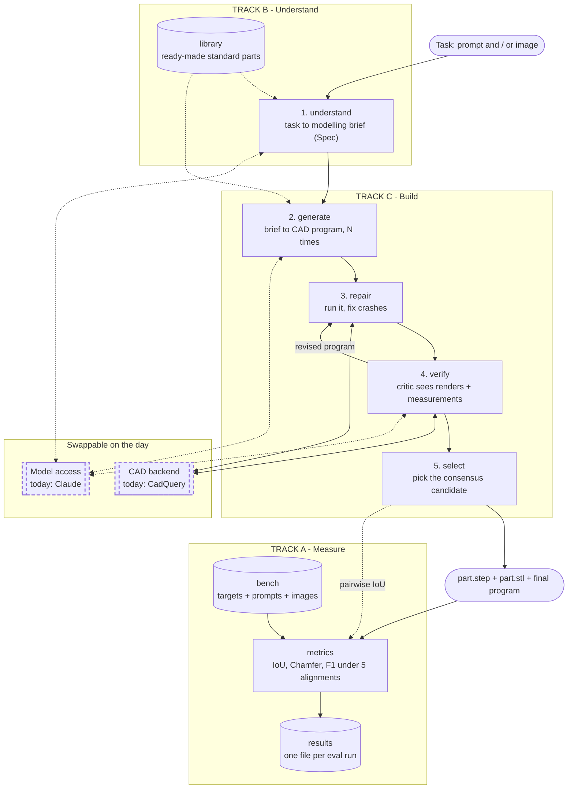
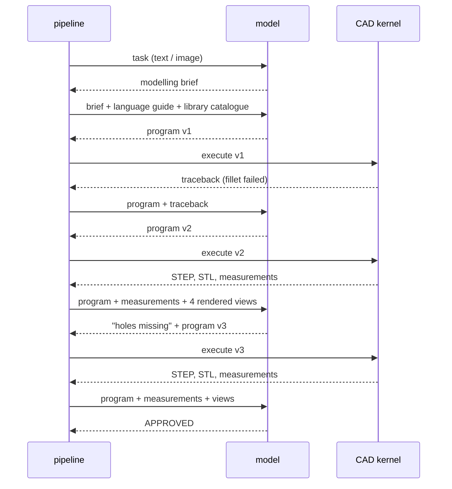
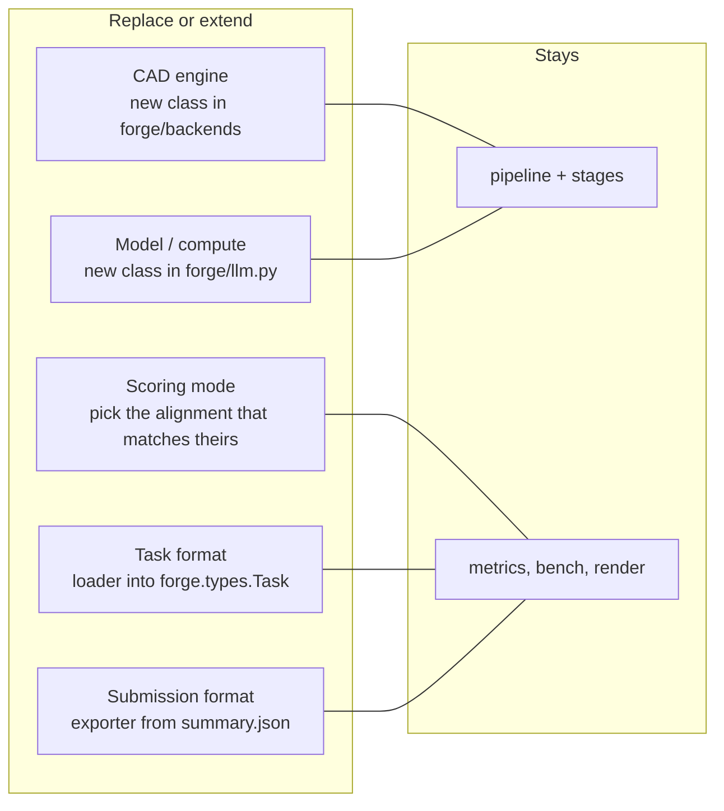

# Architecture

How the base agent works today, module by module. Read this first.

## The idea in one paragraph

We do not ask a model to draw a 3D shape. We ask it to **write a program** in a CAD
scripting language, run that program in a real CAD kernel, **measure and look at** what
came out, and let the model correct its own program. We do this several times in
parallel and keep the attempt the others agree with. The kernel guarantees the output
is a real solid; the loop catches mistakes; the vote replaces the answer key we do not
have at test time.

## The pipeline



Solid arrows are the path a task takes. Dotted arrows are services a stage calls.
The dashed boxes are the two parts we expect to replace at the briefing.

## What happens to one candidate



Three of these run in parallel. Then `select` compares the three results with each other.

## Modules

Each entry: what it does, why it exists, and what is weak about it today.

### `forge/types.py` — the contract (shared)

Three small data classes that cross stage boundaries:

- **`Task`**: what the organisers give us. `prompt`, `image`, and `base_code` (reserved for
  edit-style tasks, unused today).
- **`Spec`**: the modelling brief. `text` is what the code generator reads. `envelope` and
  `notes` are optional structured fields nobody fills yet.
- **`Candidate`**: one attempt. Carries its program, its latest kernel result, whether the
  critic approved it, and a log of what happened to it.

Because every track reads these, changing them needs all three people to agree.

### `forge/pipeline.py` — the orchestrator (shared)

`Agent.solve(task, out_dir)` calls the stages in order, runs candidates in a thread pool,
and writes `spec.md`, `final.py` and `summary.json`. It holds no modelling logic on
purpose: if it stays thin, nobody needs to edit it and nobody conflicts.

Knobs: `n_candidates` (default 3), `repairs` (3), `rounds` of critique (2), `effort`.

### `forge/stages/understand.py` — stage 1 (Track B)

Turns the task into a brief with four parts: **frame** (units, up axis, origin),
**envelope** (bounding box size), **build plan** (main body first, then features by
volume, all with absolute coordinates), and **unknowns** (every guess, stated).

Why a separate stage: the prompt we get is fixed and may be vague. A code generator
handed a vague prompt guesses silently and differently each time. Forcing the guesses
onto paper first makes all candidates share one interpretation, and puts the most
expensive mistakes (frame, proportions) under a spotlight before any code exists.

Weak today: the brief is free text, so nothing downstream can check numbers against it.
Image input gets no special treatment at all; the model just looks at the picture once.

### `forge/library/` — the knowledge base (Track B)

Tested functions for shapes that are defined by a standard or a formula. Today it holds
one: `spur_gear(module, teeth, width, bore)`, a true involute gear. `catalogue()` pastes
every helper's docstring into the prompts, so the model calls `spur_gear(...)` and never
derives an involute itself.

Weak today: one part. CadQuery-specific, so it needs porting if the engine changes.

### `forge/stages/build.py` — stages 2 and 3 (Track C)

- **`generate`** sends the task, the brief, the backend's language guide and the library
  catalogue, and pulls the last fenced code block out of the reply.
- **`run_with_repair`** executes the program. If the kernel raises, or the result is not
  one valid solid, the error goes back to the model with the instruction to keep the
  geometry and, if one operation keeps failing, build that feature a simpler way.

Why: published benchmarks show 70–90% of programs crash on hard parts. A part that fails
to build scores zero, so getting *something valid* out is worth more than any refinement.

Weak today: zero-shot, no examples of good programs in the prompt, no memory of which
errors we have already seen and how they were fixed.

### `forge/stages/verify.py` — stage 4 (Track C)

The critic gets the task, the current program, kernel measurements as text, and a
four-view render. It checks in a fixed priority order (frame, envelope, main masses,
features, edge treatments), then either says `APPROVED` or returns a corrected program.
If the correction no longer runs, we revert to the previous working version.

Why two kinds of feedback: models read numbers reliably and pictures unreliably.
Measurements catch "the box is 82 mm, not 80" and "there are 5 holes, not 6". Pictures
catch "the hole is on the wrong face", which no single number shows.

Weak today: the critic is the same model that wrote the code, so it tends to agree with
itself. It never sees the input image side by side with the render. Views are fixed.

### `forge/stages/select.py` — stage 5 (Track C)

Computes IoU between every pair of candidates and picks the one with the highest mean
agreement (the *medoid*). Critic approval adds a small bonus.

Why: at test time there is no target to score against. Independent attempts that land in
the same place are probably right; an outlier probably misread something.

Weak today: if all candidates share one misreading, consensus happily confirms it.
With two or fewer usable candidates there is no vote at all.

### `forge/backends/` — the CAD engine seam (Track C, swappable)

- **`base.py`** defines the interface: a `guide` (the cheat sheet that goes into prompts),
  a `language` (the code-fence label), and `execute(code, out_dir) -> ExecResult`.
  `describe()` turns kernel measurements into the text the critic reads.
- **`cadquery_backend.py`** implements it for CadQuery and holds the CadQuery guide.
- **`_cq_runner.py`** runs one program in its own process with a timeout, exports STEP and
  STL, and writes measurements: validity, solid count, bounding box, volume, area, centre
  of mass, face counts by type, and every cylindrical face's radius and axis.

Nothing outside this folder knows which engine is in use.

### `forge/llm.py` — the model seam (Track A, swappable)

One method: `complete(system, content_blocks, effort) -> text`. `AnthropicLLM` is the real
one; `ScriptedLLM` returns canned replies so tests run offline.

### `forge/geometry.py`, `forge/render.py` — geometry tools (Track A)

- **`load_mesh`** reads STEP, STL, OBJ into triangles. **`voxelize`** fills a grid by
  counting surface crossings along columns. **`sample_surface`** draws points on the skin.
- **`render_grid`** draws the four-view sheet the critic sees and the benchmark images.
  It is a point-splat renderer: no GPU, no display, no extra dependencies.

### `forge/metrics.py` — the score (Track A)

`compare(pred, target)` reports IoU, Chamfer distance, F1, and Hausdorff-95 under five
alignment modes (`raw`, `center`, `unit`, `rot24`, `icp`). We report all five because we
do not know yet which one the organisers use. `pairwise_iou` serves `select`.

### `forge/bench.py`, `bench/` — the practice exam (Track A)

`bench/parts/*.py` are reference programs with a `PROMPT`. `forge bench` builds each into
`bench/targets/<id>/` with a STEP, an STL, a prompt and a rendered image. Any folder
there with a `part.step` and a `prompt.txt` counts as a case, so outside data drops in.

### `forge/sensitivity.py` — what the metric punishes (Track A)

Damages each target in ten controlled ways and scores it. The result is the table in
[SCOREBOARD.md](SCOREBOARD.md). It is why every prompt says "frame first".

## What gets replaced at the briefing



| Unknown | Where it plugs in | Owner | Work if it differs from today |
|---|---|---|---|
| CAD engine | subclass `CadBackend`, register in `forge/backends/__init__.py` | C | write `guide`, write a runner that exports STEP/STL and measurements |
| Models and compute | subclass `LLM` in `forge/llm.py` | A | one method; check it accepts images |
| Their metric | `forge/metrics.py` | A | find the mode that reproduces their numbers on their examples |
| Task format | a loader that yields `Task` | A | small script |
| Submission format | read `summary.json` | A | small script |

## What a run leaves on disk

```
runs/<name>/<case>/
  spec.md            the brief
  cand0/ cand1/ cand2/
    try0/ try1/ ...  each execution: part.py, part.step, part.stl, measure.json, views.png
  final.py           the chosen program
  summary.json       which candidate won and each candidate's log
```

When a case scores badly, read `spec.md` first. If the brief is wrong, it is a Track B
problem. If the brief is right and the part is wrong, it is Track C.
