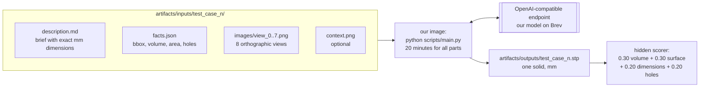
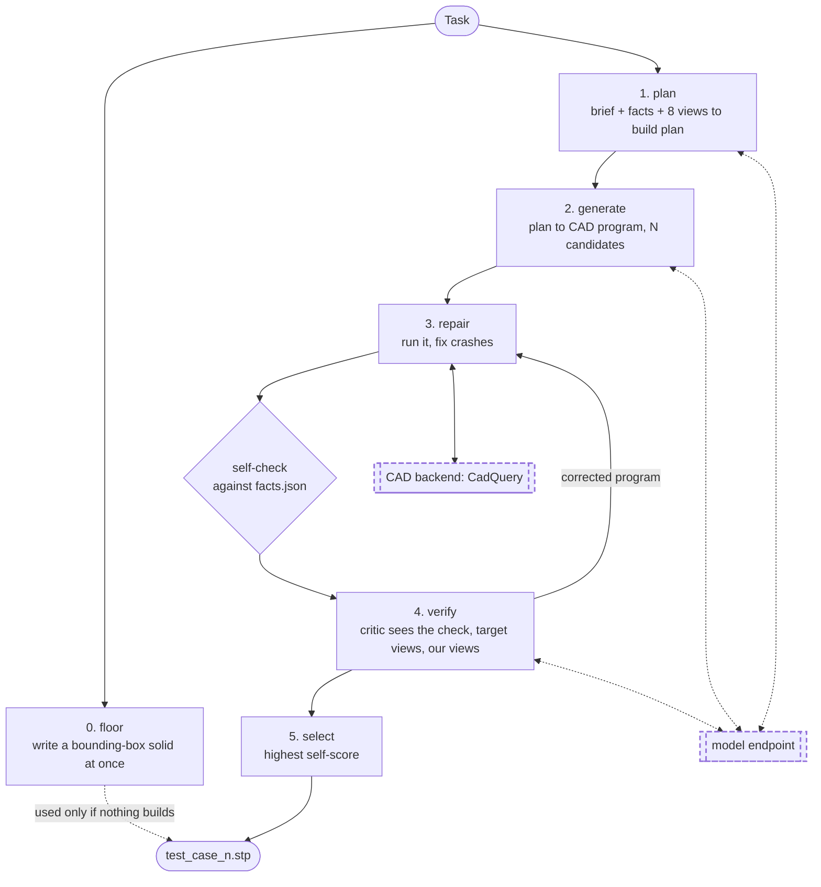

# Architecture

How the agent works after the kickoff rules. Read this first.

## The idea in one paragraph

A model **writes a CAD program**, a real CAD kernel runs it, and we **check the result
against numbers the organisers give us** for every part: exact bounding box, volume,
surface area and through-hole count (`facts.json`). The model fixes what the check
flags, we do that for several candidates, and hand in the one that matches the facts
best as a single STEP file. If nothing builds, we hand in a block of the right size,
because a missing file scores 0 and a block scores about 0.3.

## What we are given and what we return



Pose does not matter: the scorer aligns by rotation and translation first. Size and
handedness do matter: no scaling, no mirroring.

## The pipeline



## The self-check: scoring without the answer

This is the centre of the design. The organisers' score has four parts; `facts.json`
lets us compute two of them exactly at run time and estimate the other two.

| Score part | Weight | What we can do without the target |
|---|---|---|
| Dimensions | 20% | **exact**: our bounding box against `bounding_box_mm` |
| Holes | 20% | **exact**: our through-hole count against `through_holes_genus` |
| Volume overlap | 30% | estimate: our volume against `volume_mm3` |
| Surface match | 30% | estimate: our surface area against `surface_area_mm2`, plus the views |

Equal volume does not prove equal shape, so the last two are hints. The eight views are
what closes that gap (Track B).

## Modules

### `forge/types.py` — the contract (shared)

- **`Task`**: one part as handed over: `name`, `description`, `views`, `context`, `facts`,
  and `answer` (a target STEP file, which only our own reference cases have).
- **`Candidate`**: one attempt: program, latest kernel result, its self-check, a log.

### `forge/pipeline.py` — the orchestrator (shared)

`Agent.solve(task, out_dir, deadline)` runs the stages, candidates in parallel, and
returns a summary whose `step` is the file to hand in. It catches a dead model endpoint
and still returns the fallback block. Keep it thin.

### `forge/run.py` and `scripts/main.py` — the run the organisers execute (Track A)

`scripts/main.py --input_dir --output_dir` is the entry point their container calls.
`run_all` writes a bounding-box `.stp` for every task before any model call, then solves
tasks in parallel and overwrites each file when a real part is ready. It keeps the whole
run inside a time budget (default 17 of the 20 minutes).

Settings, all environment variables so they freeze with the image: `OPENAI_BASE_URL`,
`OPENAI_API_KEY`, `OPENAI_MODEL`, `FORGE_CANDIDATES` (3), `FORGE_ROUNDS` (2),
`FORGE_WORKERS` (3 tasks at once), `FORGE_BUDGET_S` (1020), `FORGE_MAX_TOKENS` (8000).

### `forge/llm.py` — model access (Track A)

`OpenAICompatLLM` talks to any OpenAI-compatible chat endpoint, which is what the rules
require. Images are downscaled before sending. `ScriptedLLM` replays canned answers so
tests need no model.

### `forge/cases.py` — task loading (Track A)

`load_tasks(dir)` reads the organisers' folder layout. `build_bench()` turns our own
reference programs (`bench/parts/`) into the same layout plus `answer.step`.

### `forge/score.py` — our copy of their scorer (Track A)

Rigid alignment (24 starting orientations, each refined by ICP), then volume IoU, surface
F-score at 0.5–10% of part size, the dimension rule (2% off loses 10%, 20% loses all) and
hole count from topology. Their scorer is not published; details we guessed are marked
`GUESS` in the file. It reads about 0.05–0.15 higher than their slide; see
[SCOREBOARD.md](SCOREBOARD.md).

### `forge/facts.py` — the self-check (Track B)

`self_check(measure, facts)` returns the exact dimension and hole scores, volume and
area ratios, a combined `self_score`, and a list of plain-language issues such as
"through-holes: built 5, target 6" or "no cylindrical face of diameter 6.75 mm".

### `forge/stages/understand.py` — stage 1 (Track B)

Lays out brief, facts and the eight labelled views for the model, and asks for a build
plan: base body, features by volume, the list of through-holes (which must equal the
facts), and the gaps the brief leaves that must be read from the views.

Weak today: the views are only shown to the model. Nothing measures them.

### `forge/render.py`, `forge/geometry.py` — geometry tools (Track B)

`render.py` draws our part with the organisers' eight cameras, so view k of ours lines up
with view k of theirs. `geometry.py` tessellates STEP, voxelises, samples surfaces and
counts through-holes (genus) from the mesh.

### `forge/stages/build.py` — stages 2 and 3 (Track C)

`generate` writes a program from the plan. `run_with_repair` executes it, feeds kernel
errors back, and attaches the self-check to every candidate that builds.

### `forge/stages/verify.py` — stage 4 (Track C)

The critic sees the self-check, kernel measurements, the target's eight views on one
sheet and ours on another. A revision is kept only if the self-score does not drop.

### `forge/stages/select.py` — stage 5 (Track C)

Picks the candidate with the highest self-score. Without facts it falls back to the
candidate that overlaps most with the others.

### `forge/backends/` — the CAD engine (Track C)

The organisers accept any tool that writes a STEP solid, so CadQuery stays unless a
measured comparison says otherwise. `_cq_runner.py` runs each program in a subprocess
with a timeout, writes `part.step` and `measure.json` (validity, bounding box, volume,
area, face types, every cylinder's radius and axis, through-hole count).

### `forge/library/` — ready-made standard parts (Track C)

Tested generators the model calls by name. One so far: `spur_gear`.

## Files a run leaves behind

```
<work>/<task>/
  plan.md                 the build plan
  cand0/ cand1/ cand2/
    try0/ try1/ ...       each execution: part.py, part.step, measure.json, views.png
    target_views.png      the organisers' 8 views on one sheet
  fallback/               the bounding-box solid
  final.py                the chosen program
  <task>.step             the chosen part
  summary.json            winner, its self-check, every candidate's log
<outputs>/<task>.stp      what gets submitted
```

When a part scores badly: read `summary.json` for the self-check issues, then `plan.md`.
A wrong plan is a Track B problem; a right plan with a wrong part is Track C.
