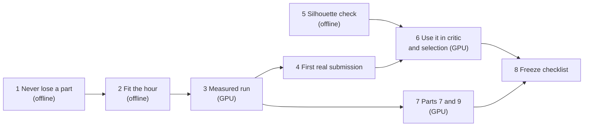

# Plan from 12 Nov

State and measurements: [HANDOFF.md](HANDOFF.md). Code freeze: Fri 13 Nov, 08:00.

**Goal for Thursday:** one command, under 55 minutes, nine parts, no part lost to a
timeout, submitted from `main` and reproducible. Then raise shape.



Steps 1, 2 and 5 need no GPU. Do them before the instance is started. Steps 1 and 2
start from branch `c/facts-driven`.

## Expected effect

| Step | Leaderboard mean, rough | Basis |
|---|---|---|
| today, hand-picked | 0.658 | measured |
| 1 + 2 + 3 + 4: the same parts from one real run | about 0.65 | same candidates, now kept |
| 7: parts 7 and 9 build at about 0.6 | +0.08 | two boxes at 0.21 today |
| 5 + 6: shape check steers critic and selection | +0.05 to +0.10 | built parts earn 0.23–0.48 of 0.60 shape points |

These are estimates, not measurements.

---

## Step 1. Never lose a part (offline, shared file: own pull request)

**Why:** three parts with good candidates were written as boxes, and a hard stop at one
hour would lose every unfinished part.

**Read:** `forge/pipeline.py`, `forge/run.py`, `forge/stages/select.py`, `forge/types.py`.

**Change:**
1. In `Agent.solve`, catch exceptions inside `work(i)` so one failed call ends that
   candidate only. Record the error in `cand.log`.
2. Make the output "anytime": whenever a candidate's self-score beats the best so far
   for that part, copy its STEP to the part's output path at once (write to a temporary
   name, then rename). The box is the first "best". The end of `solve` then has nothing
   left to lose.
3. `run_all` passes the output path into `solve`, so the file in the output folder is
   always the best known solid.

**Done when:** `uv run pytest -q` passes with two new tests: (a) a scripted model whose
second call raises still yields the first candidate's part, not the box; (b) killing
`solve` after the first candidate leaves that candidate's file in the output folder.

## Step 2. Fit the hour (offline)

**Why:** 69 minutes with a 55-minute budget; calls that think for 32,000 tokens and
return nothing; the GPU saturated at 27 parallel long requests.

**Read:** `forge/llm.py`, `forge/run.py`, `forge/pipeline.py`, `forge/stages/*.py`,
`Dockerfile`.

**Change:**
1. Per-call thinking: `LLM.complete(system, content, think=False)`. Plan: thinking on
   at low effort. Code, repair and critic: thinking off. Settings stay environment
   variables (`FORGE_PLAN_EFFORT`, default `low`).
2. Per-call timeout = min(`FORGE_LLM_TIMEOUT_S`, time left for this part). No retry
   when less than two minutes remain. Default `FORGE_LLM_TIMEOUT_S=300`,
   `FORGE_MAX_TOKENS=8000`.
3. Deadline per part, set by `run_all`: total budget (`FORGE_BUDGET_S=3000`) shared so
   that every part gets its turn; when the deadline passes, the part stops starting new
   calls and its best file is already in place (step 1).
4. Defaults: `FORGE_CANDIDATES=2`, `FORGE_WORKERS=9`, `FORGE_ROUNDS=1`. That is at most
   18 requests in parallel.
5. Fitting: at most 12 kernel runs per part, once, on the chosen candidate only.
6. `forge eval`: record the box's own self-score for a fallback, and print wall-clock
   and parts built.

**Done when:** tests pass, including one where a scripted model that sleeps past the
deadline still lets `run_all` return in time with a file for every part.

## Step 3. Measured run (GPU, about 1 hour)

Start the server and tunnel (HANDOFF). Then, from the branch with steps 1 and 2:

```bash
set -a && . ./team-g.env && set +a
nohup uv run python -m forge eval --inputs artifacts/inputs --tag a-anytime-run \
  -o runs/anytime > runs/anytime.log 2>&1 &
```

**Record:** wall-clock, parts built, self-score per part, calls that timed out or were
cut off (the log prints both). **Pass:** under 55 minutes, at least 7 parts built, none
lost. If it fails on time: 1 candidate for parts with 30 faces or fewer, 2 otherwise.
If it fails on parts built: read the candidate logs of the failing part before changing
anything.

Optional, 20 minutes: restart the server with `MODEL=Qwen/Qwen3.8-27B-FP8` and compare
speed and parts built on cases 1, 5, 8. Keep it only if nothing gets worse.

## Step 4. First real submission

Run `scripts/main.py` into `artifacts/outputs` with the code being merged, check all
nine with `forge check`, merge steps 1–3 to `main`. Write the leaderboard number into
the result file and the scoreboard. From here on, only reproducible runs go to `main`.

## Step 5. Silhouette check (offline, Track B, can start now)

**Why:** 0.60 of the score is shape and our self-score cannot see it (part 5: self-score
0.98, leaderboard 0.71).

**Read:** `forge/render.py` (the organisers' eight cameras), `forge/facts.py`,
`docs/tracks/B-see.md`, one `artifacts/inputs/test_case_*/images/` folder.

**Build:** `forge/vision.py`: for each of the six axis views, turn the organisers' image
into a mask (part against background), render our candidate from the same camera into
a mask, crop both to their own bounding rectangle, resize to the same grid, and take
intersection over union. Shape score = mean over views. Cropping removes the need to
know their image scale. Check left/right orientation on an asymmetric part first.

**Test it against the leaderboard before using it:** `bench/calibration/` holds 18 STEP
files with a leaderboard score each (nine picked candidates, nine boxes). Compute
"shape points" = leaderboard − 0.2 × dimensions − 0.2 × holes for each and compare with
the silhouette score. **Keep it if** it orders the parts as the leaderboard does
clearly better than the volume and area ratios do (rank correlation; report both).

## Step 6. Use the shape score (GPU)

Only if step 5 passed. Replace the volume and area terms of the self-score with a blend
that includes the shape score; give the critic the per-view scores and the worst view's
difference image; select by the new score. Measure on the nine parts before and after.
Fit dimensions (step 2.5) against the new score, not total volume alone.

## Step 7. Parts 7 and 9 (GPU, Track C)

Both produced no building candidate. First read
`runs/qwen-facts2/work/test_case_7` and `_9` candidate folders (on Robin's laptop) for
the kernel errors. Likely remedy, in order: thinking off so repairs get their turns
(step 2 may already fix it); build the body first and add features one at a time,
keeping a feature only if the part still builds and the score does not drop; a short
worked example for a bore on a tilted axis and for a V-shaped block.

## Step 8. Freeze checklist (Thursday evening)

- [ ] Port 8000 public, `OPENAI_BASE_URL` in `team-g.env` is the public address, tested from outside
- [ ] `Dockerfile` defaults equal the settings of the best measured run
- [ ] `docker build` and a full run inside the container, non-root, writing only to the output folder and `/tmp`
- [ ] All nine `artifacts/outputs/*.stp` regenerated by the merged code; `forge check` on each
- [ ] Enough Brev credit left for the instance to stay up through the organisers' run
- [ ] `team-g.env` ready to hand over; `team-g.secrets.env` deleted from the laptop once no longer needed
- [ ] Three slides: approach, numbers (box 0.32 → ours), cost per part with an open model

## Who can do what

| Step | Needs GPU | Suited to a cheaper coding agent |
|---|---|---|
| 1, 2 | no | yes: well specified, tested offline |
| 5 | no | yes, with the calibration test as the acceptance check |
| 3, 4 | yes | run by a person, 1 hour |
| 6, 7 | yes | needs judgement on the pictures and logs |
