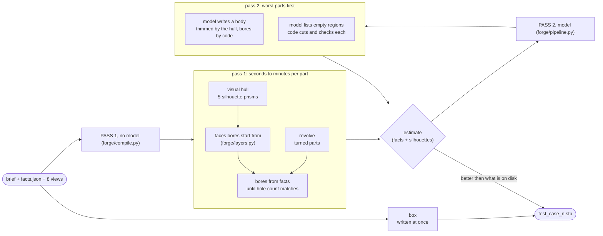

# Plan v3, Thu 12 Nov (after the night session)

Replaces the plan of 11 Nov and the "Plan v2" draft. State and measurements:
[HANDOFF.md](HANDOFF.md). Numbers: [SCOREBOARD.md](SCOREBOARD.md). Code freeze:
**Fri 13 Nov, 08:00**. Where this disagrees with the backlog order in `docs/tracks/*.md`,
this file wins. We are four people: Robin plus one person each on tracks A, B and C.

## What changed overnight

Plan v2 said: stop asking the model for the whole part; let code build everything it can
from `facts.json` and the views, and let the model write only what code cannot. That is
now built and measured.

| Yesterday | Now (branch `a/two-pass`) |
|---|---|
| model plans, then writes the full program (3–5 min per call, often empty) | no plan call |
| 7 of 9 parts built by hand-picking; 2 complex parts were boxes | **9 of 9 built with no model call**, in about 6 minutes |
| hole count right on the parts that built | **dimensions and hole count exact on all nine**, from code |
| good candidates lost to a timeout | the output file is always the best part so far; nothing waits for the end |
| self-score blind to shape | silhouette check against all eight views, exact framing |
| run over the hour (69 min) | 6 min without the model, 28 min with it |



Three ideas carry this:

1. **A silhouette body contains the true part.** Each view's outline, extruded through
   the box along its view direction, is a prism the part must lie inside. The
   intersection of five prisms (three axis views, two isometric) is a B-rep with exact
   outer dimensions. Framing is exact because the organisers fit the projected
   *bounding box* into 985 of 1024 pixels and we know the bounding box.
2. **The facts give every bore exactly**, and the through-hole count we must hit. Bores
   are cut pattern by pattern, each drilled as far as needed (as listed, opened to the
   nearer side, or fully through) until the count equals `through_holes_genus`.
3. **What we can see is empty in front.** If a view shows the rim of a bore exactly where
   the facts put it, the flat face around that rim is at a known plane, and the space on
   the line of sight in front of it is empty. That removes pockets and recessed faces
   that no outline shows (part 9: volume ×1.54 → ×1.23).

What is left over is material **hidden from every outline and not next to a bore**:
hollow interiors, fins, pockets with sloped floors. Parts 6 (×3.2 too full) and 7 (×1.9)
are the two that carry most of the remaining points.

## The approaches, ready to submit one at a time

Each folder in `bench/approaches/` holds nine STEP files and `scores.json`. "Estimate"
is our local stand-in for the leaderboard (see the scoreboard for how far to trust it;
it reproduces the two values we know to within 0.01). None of 01–05 has been submitted.

| Order | Approach | Estimate | What the leaderboard value will tell us |
|---|---|---|---|
| 1 | `01-no-model` | 0.773 | what hull + bores alone are worth; calibrates the estimate on hulls |
| 2 | `04-no-model-faces` | 0.794 | whether the face carving is a real gain (parts 1, 5, 9) |
| 3 | `03-two-pass-qwen-think-cuts` | 0.807 | whether the model's bodies and cut lists help or hurt on 2, 4, 6, 8 |
| 4 | `05-faces-qwen-think-cuts` | see scoreboard | the best of both; our candidate for the final configuration |

Submit with `scripts/submit_approach.sh <name>` (stages the files into
`artifacts/outputs`, sets the Dockerfile defaults, commits). **Twenty minutes between
submissions.** After each one, write the value into
`bench/approaches/<name>/scores.json` (`"leaderboard"`) and, per part if the board shows
it, into the scoreboard. Do 1 and 2 first: they need no GPU and are fully repeatable.

---

## Who does what today

| | Question | Number to move | First step |
|---|---|---|---|
| **Robin** | Which approach goes in the final image, and with which model settings? | leaderboard | submit 1–4 in order, read the per-part values |
| **Track A: Ship** | Does the image do the same on the organisers' machine as on Robin's laptop? | wall-clock in Docker; a public endpoint that stays up | A1 below |
| **Track B: See** | Can we read the depth of what the outline hides? | true local score on our hollow reference parts: 0.68 and 0.53 today | B1 below |
| **Track C: Compile** | How much of the overfill on parts 6 and 7 can code remove? | volume ratio of the no-model part: ×3.2 and ×1.9 today | C1 below |

Every task below is offline unless it says GPU, takes one to three hours, and ends in one
number. Start by running the two commands under "How to measure", so you see the
numbers you are about to move.

### How to measure (no GPU, about 6 minutes)

```bash
uv sync && uv run pytest -q
uv run python scripts/compile_all.py -o runs/compile-mine --tag <track>-<idea>   # all nine practice parts, no model
uv run python scripts/bench_nomodel.py --tag <track>-<idea>-bench                # 12 parts WITH answers: true local score
uv run python scripts/approaches_table.py                                         # what is filed so far
```

`compile_all.py` prints, per part and per body source: estimate, dimensions, holes,
volume ratio, silhouette IoU. `bench_nomodel.py` is the only place we have real answers.

### Track A: Ship

**A1. Run the image as the organisers do (first thing).** `docker build --platform
linux/amd64`, then run with `--user 1000:1000`, a read-only input folder and no model
(`-e FORGE_MODEL_PASS=off`). Pass: nine `.stp` files, each passes `forge check` with
holes 1.00, and the files match `bench/approaches/04-no-model-faces` (same estimate to
0.01). Report wall-clock and the CPU count you ran on. Pass 1 starts one process per
part; on a small machine it may need `FORGE_WORKERS=4`.
**A2. Time pass 1 on few cores.** `docker run --cpus 4` and `--cpus 8`. If a part passes
`FORGE_PASS1_S` (600 s) it keeps what it had, so nothing is lost, but the hole search may
be cut short. Find the slow step with the per-part seconds and tell Track C.
**A3. Public endpoint and handover file** (old freeze checklist, unchanged): port 8000
public, `team-g.env` with the public address, tested from a machine that is not on the
tunnel. Ask the organisers the three open questions in the handoff.
**A4. Repeatability.** Pass 1 is deterministic: run it twice, the files must be
identical in volume and hole count. For the model pass set `FORGE_TEMPERATURE=0
FORGE_SEED=1` and compare two runs (GPU, 30 min each).
**A5. Leaderboard log.** After each of Robin's submissions, per-part values into the
scoreboard. The estimate was fitted on 16 files; with four more submissions refit it
(`scripts/calibrate_shape.py` shows how) and say which term carries the error.

### Track B: See

**B1. A renderer that draws our reference parts the way the organisers do** (the key
tool we lack). `bench/cases/` has 12 parts with answers, but their views are silhouettes
only, so nothing that reads *inside* the outline can be tested against an answer. Write
`forge/render.py: render_organiser_style(mesh_or_step, camera)`: flat shade per face from
one fixed light (the practice views show three distinct shades for +X, −Y and +Z faces
in the isometric view), black strokes on outline and sharp edges, white background, same
framing as `forge/vision.py: Camera`. Check: `shape_score` of an answer against its own
render is above 0.995, and the stroke test in `forge/layers.py` (`STROKE`) finds the
edges. Then `scripts/bench_nomodel.py` can use it instead of plain silhouettes.
**B2. Depth of flat faces (the enclosure problem).** `06_enclosure` scores 0.68 and
`08_elbow` 0.53 with no model, because a hull fills a hollow. `forge/layers.py:
face_depths` already finds the depth of a flat face by sliding it along the view
direction until it lands on one evenly shaded patch of the isometric view (it finds part
5's front face at 22.24 mm, which is exact). `carve_layers` cuts those faces but is not
wired in: on the practice parts it gained nothing and small regions matched by accident.
With B1 you can test it against answers. Target: enclosure above 0.95 with no model.
**B3. Tilted and curved faces.** Parts 6 (fins) and 7 (ribs, pocket in the flange) are
too full by ×3.2 and ×1.9. The fins of part 6 are flat faces seen in the isometric
views; the same idea as B2 with a plane that is not axis-aligned.
**B4. Does the estimate rank parts as the leaderboard does?** Once A5 has four more
submissions, report rank correlation per ingredient and refit `forge/compile.py:
estimate`.

### Track C: Compile

**C1. Part 6: radial patterns.** The part is a cone with V grooves; the hull and the
revolve are both ×3.2 too full, the worst part we have (estimate 0.49, the model reaches
0.62). The top view shows the groove pattern as strokes, the brief gives the symmetry.
Try: detect an n-fold pattern in the top view (rotate the stroke image by 360/n and
compare), cut one wedge found from the isometric view, repeat it around the axis. Keep it
general: trigger on the pattern, never on the part number.
**C2. Bore search leftovers.** Part 8 reaches the hole count only by skipping 12 small
bores (`compile.json` → `note`), because cutting them adds loops. Find which crossings
are real (the true part has 11 through-holes) and keep those bores. Number: bores
skipped on part 8, 12 → 0 with holes still 1.00.
**C3. Pass 1 speed.** 6 minutes on 15 cores; part 7 takes 335 s, most of it in
`carve_mouth_faces` (one silhouette check per candidate face). Reject faces with nothing
in front of them before the expensive check. Target: under 2 minutes per part.
**C4. Smoother outlines.** Hull outlines are polygons from pixels (about 0.7 px
tolerance). Fit lines and arcs so curved faces are cylinders again; the surface score is
checked down to 0.5% of part size. Measure on `bench_nomodel.py` (surface term).
**C5. Recipes from shafts and bosses.** `cylindrical_shafts_and_bosses` in the facts is
unused. For shaft-like parts (part 4) exact cylinders could replace the pixel outline.

### Robin: the model, where it still adds points

1. Submit the four approaches and read the per-part values. The model pass is only worth
   keeping if `03` beats `01` on the leaderboard by more than its estimate noise.
2. The model's bodies are weak with thinking off (below the no-model part on 7 of 9) and
   useful with thinking on (parts 4 and 6). Its cut lists are mostly rejected by the
   checks. If the organisers allow a hosted model, this is where a stronger model pays.
3. Final settings into the Dockerfile, full run in Docker, outputs committed with the
   code that made them. Feature freeze 02:00 Friday as before.

---

## Order today

| By | Milestone |
|---|---|
| 09:30 | everyone has run "How to measure"; Robin has submitted `01-no-model` |
| 11:00 | `04` and `03` submitted; A1 done (image runs as non-root, same files) |
| 14:00 | fourth submission; B1 renderer checked against answers; C1 or C2 has a number |
| 18:00 sync | decide the final configuration from leaderboard values, not estimates |
| evening | merges of B and C work that moved a number, each with a submission |
| 02:00 | feature freeze, full run in Docker, final outputs committed |
| 06:00–08:00 | handover file, endpoint check from outside, three slides |

## Risks

- **`facts.json` on the hidden parts** is still unconfirmed. Without it pass 1 has no
  bounding box and only the model path runs. Ask today.
- **The estimate is not the leaderboard.** It was fitted on boxes and model-written
  bodies; a hull matches every silhouette by construction, so on hulls it leans on the
  volume ratio alone. The first two submissions settle how much to trust it.
- **Model cut lists** raise the estimate whenever they remove volume without touching a
  silhouette; that does not prove the cut is in the right place. Approach 03 against 01
  on the leaderboard is the test.
- **Hollow parts** (covers, housings) are the hull's worst case and the hidden set may
  have one. B2 is the remedy; until then the model pass is the only thing that helps.
- **Tuning to nine parts.** Every rule added tonight triggers on a pattern in the facts
  or the views. Keep it that way.
