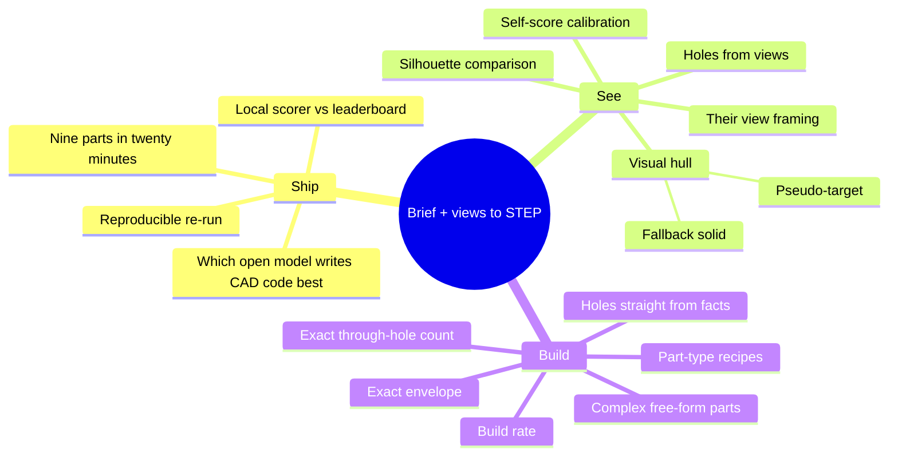

# Research map

Open problems after the kickoff, and the vocabulary to search them with. Questions the
kickoff answered are gone; the ones for the organisers are in
[STRATEGY.md](STRATEGY.md#still-open-ask-the-organisers).

## Map

## Open questions, ranked by expected payoff

| # | Question | Track | Why it matters | Status |
|---|---|---|---|---|
| 1 | What does the base agent score on the leaderboard? | A | nothing else is measurable before this | not submitted |
| 2 | Which servable model is best at this, within 20 minutes? | A | the model is the largest single lever | open |
| 3 | Can we hit dimensions and hole count exactly on every part? | C | 40% of the score, and we are told the answers | open |
| 4 | Does silhouette comparison catch wrong shapes that volume and area miss? | B | 60% of the score has no exact check yet | not built |
| 5 | How good is a visual-hull solid as a fallback? | B | lifts the floor on parts the agent cannot model | not built |
| 6 | How well does the self-score predict the leaderboard? | B + A | selection and the critic both rely on it | needs submissions |
| 7 | How far can a program get on parts with 300–600 faces? | C | a third of the score is the complex tier | open |
| 8 | Do generated holes from the facts inventory beat model-written holes? | C | removes the most common counting mistake | open |
| 9 | How repeatable is one run? | A | the organisers compare a re-run with our submission | open |

## Glossary

| Term | Meaning |
|---|---|
| B-rep | Boundary representation: a solid stored as exact faces, edges and vertices. What STEP files hold. |
| STEP (.stp) | The standard exchange file for B-rep solids. The only format we may submit. |
| CAD kernel | The geometry engine that computes solids. OpenCASCADE sits under CadQuery and build123d. |
| Through-hole / genus | A hole that passes fully through. The genus of a solid is how many it has (a mug handle counts as one). |
| Blind hole | A hole with a bottom. Does not count as a through-hole. |
| Envelope | The bounding box of the part. |
| Revolve / sweep / loft / shell | Spin a profile about an axis / drag it along a path / blend between profiles / hollow a solid. |
| Fillet / chamfer | A rounded / bevelled edge. Many faces, little volume. |
| Tessellation | Approximating a B-rep by triangles, for rendering and scoring. |
| Volumetric IoU | Shared volume divided by combined volume. |
| F-score | Share of surface points within a tolerance of the other surface, both directions combined. |
| Rigid alignment | Moving and rotating one shape onto another without scaling or mirroring. |
| ICP | Iterative closest point: a method that refines a rigid alignment. |
| Handedness | Whether a part is the left- or right-handed version. A mirror image is a different part. |
| Orthographic view | A view with no perspective: parallel lines stay parallel, sizes can be measured. |
| Silhouette | The outline of the part in a view, as a filled mask. |
| Visual hull | The largest shape consistent with all silhouettes; found by carving a block. |
| Pseudo-target | A stand-in for the hidden target, built from the inputs, to score candidates against. |
| Self-score | Our estimate of the score from `facts.json` and the views, without the answer. |
| Superquadric | A family of smooth convex primitives (box-like to ball-like) used to approximate shapes. |
| vLLM | A server that hosts open models behind an OpenAI-compatible interface. |
| Medoid | The member of a group closest on average to the others. Our selection rule when facts are missing. |

## Reading list

| Source | Read it for |
|---|---|
| [CADSmith](https://arxiv.org/html/2603.26512v1) | numeric validation against kernel measurements; closest to our loop |
| [CADCodeVerify](https://arxiv.org/html/2410.05340v2) | question-and-answer feedback on renders |
| [ToolCAD](https://arxiv.org/abs/2604.07960) | engine text feedback vs visual feedback; step-level feedback |
| [BenchCAD](https://arxiv.org/html/2605.10865v1) | multi-view image to CadQuery; failure modes |
| [Text2CAD-Bench](https://arxiv.org/html/2605.18430v1) | why sweep, loft and shell fail to build |
| [text-to-cad plugin](https://github.com/earthtojake/text-to-cad) | build123d modelling guide; asserts inside the model |
| [CadQuery docs](https://cadquery.readthedocs.io/) | the API the model writes |
