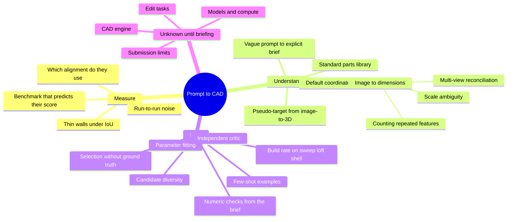

# Research map

Where the open problems are, and the vocabulary to search them with.

## Map

## Open questions, ranked by expected payoff

| # | Question | Track | Why it matters | Status |
|---|---|---|---|---|
| 1 | Which alignment and metric do the organisers use? | A | decides whether frame errors cost 0.8 or nothing | ask at briefing |
| 2 | What is our real baseline? | A | no experiment means anything without it | not run |
| 3 | Which default frame matches targets when the prompt is silent? | B | wrong up axis scores 0.16 under absolute comparison | open |
| 4 | What makes programs crash, by category? | C | a crash is a zero | open |
| 5 | How do we get proportions out of an image? | B | image input is where general models are weakest (~0.40 published) | open |
| 6 | Does the critic help or hurt per round? | C + A | published gain is about +0.15, ours is unmeasured | needs per-stage eval |
| 7 | Does consensus pick the best candidate? | C + A | free points if selection regret is large | needs per-stage eval |
| 8 | Can an image-to-3D mesh serve as a test-time target? | B + C | would give us a score to climb during inference | speculative |
| 9 | Do few-shot examples raise build rate on hard operations? | C | published crash rates reach 70–90% on sweep and loft | open |
| 10 | How noisy is one eval run? | A | sets the smallest improvement worth merging | open |

## Glossary

| Term | Meaning |
|---|---|
| B-rep | Boundary representation. A solid stored as exact faces, edges and vertices. What CAD systems and STEP files use. |
| STEP | The standard exchange file for B-rep solids. |
| CAD kernel | The geometry engine that computes solids. OpenCASCADE is the open-source one under CadQuery, build123d and FreeCAD. |
| CSG | Constructive solid geometry: building shapes by union, cut and intersection of simpler ones. |
| Feature history | The ordered list of operations (sketch, extrude, fillet…) that produces a part. Our programs are feature histories. |
| Sketch-and-extrude | Draw a 2D profile, push it into 3D. The bread and butter of mechanical CAD. |
| Revolve / sweep / loft / shell | Spin a profile about an axis / drag it along a path / blend between profiles / hollow a solid. The operations models fail at most. |
| Tessellation | Approximating a B-rep by triangles. Needed for rendering and scoring. |
| Voxel | A small cube in a 3D grid. A voxelised part is the set of cubes inside it. |
| IoU | Intersection over union: shared volume divided by combined volume. 1 is identical, 0 is disjoint. |
| Chamfer distance | Average distance from points on one surface to the nearest point on the other, both ways. Lower is better. |
| F-score / F1 | Share of surface points within a tolerance of the other surface, combining both directions. |
| Hausdorff distance | The worst-case surface distance. Sensitive to a single stray feature. |
| ICP | Iterative closest point: nudging one shape onto another to best align them. |
| Canonical pose | An agreed position and orientation so two shapes can be compared fairly. |
| Envelope | The bounding box of the part. |
| Medoid | The member of a group closest on average to all the others. Our selection rule. |
| Self-consistency | Sampling several answers and trusting what they agree on. |
| Critic / judge | A model call that reviews an output instead of producing one. |
| Few-shot | Showing the model worked examples in the prompt. |
| RAG | Retrieval-augmented generation: fetching relevant documents or examples into the prompt. |
| Involute | The tooth curve of standard gears. Defined by a formula from module, tooth count and pressure angle. |
| Module | Gear tooth size: pitch diameter divided by tooth count. |
| Pseudo-target | A rough stand-in for the hidden target, built at test time, to score candidates against. |
| Build rate | Share of tasks where we produce a valid solid. Its complement is the invalidity rate. |

## Reading list

Start with the first two; they are closest to what we are building.

| Paper | Read it for |
|---|---|
| [CADSmith](https://arxiv.org/html/2603.26512v1) | planner + coder + numeric validator + judge loop; the ablation table |
| [CADCodeVerify](https://arxiv.org/html/2410.05340v2) | visual question-answer feedback on renders |
| [BenchCAD](https://arxiv.org/html/2605.10865v1) | image-to-CAD failure modes; 106 industrial part families |
| [Text2CAD-Bench](https://arxiv.org/html/2605.18430v1) | prompt styles, difficulty tiers, why build failures dominate |
| [CADTests](https://arxiv.org/html/2605.07807v1) | why a single distance metric is a weak judge |
| [cadrille](https://arxiv.org/pdf/2505.22914) | multi-modal input (image, text, points) to CadQuery |
| [CAD-Recode](https://arxiv.org/pdf/2412.14042) | CAD-as-Python-code as the output representation |
| [GIFT](https://arxiv.org/pdf/2603.27448) | using geometric feedback to improve image-to-CAD |
| [Text-to-CadQuery](https://arxiv.org/pdf/2505.06507) | a large set of prompt and CadQuery pairs |
| [Clarify Before You Draw](https://arxiv.org/pdf/2602.03045) | handling under-specified prompts |
