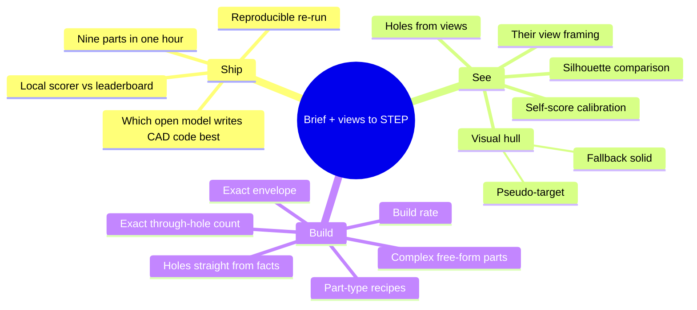

# Research map

Open problems after the kickoff, and the vocabulary to search them with. Questions the
kickoff answered are gone; the ones for the organisers are in
[STRATEGY.md](STRATEGY.md#still-open-ask-the-organisers).

## Map

## Open questions, ranked by expected payoff (updated 11 Nov, 23:00)

Numbers behind this ranking are in [SCOREBOARD.md](SCOREBOARD.md#our-runs); the work
order is in [PLAN.md](PLAN.md).

| # | Question | Track | Why it matters | Status |
|---|---|---|---|---|
| 1 | Can one run build all nine parts inside an hour, with no part lost to a timeout? | A + shared | today's 0.658 is hand-picked; the real run wrote 4 of 9 and took 69 min | **next** |
| 2 | Does a silhouette check against the eight views predict the leaderboard's shape points? | B | 0.60 of the score has no check; self-score reads up to 0.27 too high | **next**, calibration data ready |
| 3 | What makes parts 7 and 9 (complex tier) fail to build at all? | C | two boxes cost about 0.10 of the mean | open |
| 4 | Where is the misplaced material on parts 4, 5, 6, 8? | C + B | 0.23–0.33 of 0.60 shape points on each | open; look at the pictures first |
| 5 | Does fitting to total volume help or hide errors? | C | part 5: volume ×1.00, shape half right | open; fit only after shape is checked |
| 6 | Is a quantised model (FP8) faster with no loss? | A | more parallel requests, shorter calls | untested |
| 7 | How repeatable is one run? | A | the organisers compare a re-run with our submission | open |
| 8 | How good is a visual-hull solid as a fallback? | B | lifts the floor on parts the agent cannot model | not built |

Answered on 11 Nov:

- **Which model?** Qwen3.8-27B (open, vision, Apache 2.0) serves on one 96 GB card and
  builds 7 of 9 practice parts. Not compared with another model yet.
- **Dimensions and hole count exactly?** Yes on every part that builds, once the bores
  are cut from `facts.json` by plain code.
- **Is the brief regular?** Yes: all nine have the same sections (type, envelope,
  overall shape, features, edges). Every bore is fully specified in both the brief and
  the facts. Simple parts can be rebuilt from text alone; complex parts leave body
  dimensions unstated (wall thickness, bank depth), which the views and the known
  volume have to supply.
- **Self-score vs leaderboard?** Good for dimensions and holes, 0.00–0.27 too high
  overall; see the scoreboard.

## Glossary

| Term | Meaning |
|---|---|
| B-rep | Boundary representation: a solid stored as exact faces, edges and vertices. What STEP files hold. |
| STEP (.stp) | The standard exchange file for B-rep solids. The only format we may submit. |
| CAD kernel | The geometry engine that computes solids. OpenCASCADE sits under CadQuery and build123d. |
| Through-hole / genus | A hole that passes fully through. The genus of a solid is how many it has (a mug handle counts as one). |
| Blind hole | A hole with a bottom. Does not count as a through-hole. |
| Envelope | The bounding box of the part. |
| Revolve / sweep / loft / shell | Spin a profile about an axis / drag it along a path / blend between profiles / hollow a solid. |
| Fillet / chamfer | A rounded / bevelled edge. Many faces, little volume. |
| Tessellation | Approximating a B-rep by triangles, for rendering and scoring. |
| Volumetric IoU | Shared volume divided by combined volume. |
| F-score | Share of surface points within a tolerance of the other surface, both directions combined. |
| Rigid alignment | Moving and rotating one shape onto another without scaling or mirroring. |
| ICP | Iterative closest point: a method that refines a rigid alignment. |
| Handedness | Whether a part is the left- or right-handed version. A mirror image is a different part. |
| Orthographic view | A view with no perspective: parallel lines stay parallel, sizes can be measured. |
| Silhouette | The outline of the part in a view, as a filled mask. |
| Visual hull | The largest shape consistent with all silhouettes; found by carving a block. |
| Pseudo-target | A stand-in for the hidden target, built from the inputs, to score candidates against. |
| Self-score | Our estimate of the score from `facts.json` and the views, without the answer. |
| Superquadric | A family of smooth convex primitives (box-like to ball-like) used to approximate shapes. |
| vLLM | A server that hosts open models behind an OpenAI-compatible interface. |
| Medoid | The member of a group closest on average to the others. Our selection rule when facts are missing. |

## Reading list

| Source | Read it for |
|---|---|
| [CADSmith](https://arxiv.org/html/2603.26512v1) | numeric validation against kernel measurements; closest to our loop |
| [CADCodeVerify](https://arxiv.org/html/2410.05340v2) | question-and-answer feedback on renders |
| [ToolCAD](https://arxiv.org/abs/2604.07960) | engine text feedback vs visual feedback; step-level feedback |
| [BenchCAD](https://arxiv.org/html/2605.10865v1) | multi-view image to CadQuery; failure modes |
| [Text2CAD-Bench](https://arxiv.org/html/2605.18430v1) | why sweep, loft and shell fail to build |
| [text-to-cad plugin](https://github.com/earthtojake/text-to-cad) | build123d modelling guide; asserts inside the model |
| [CadQuery docs](https://cadquery.readthedocs.io/) | the API the model writes |
