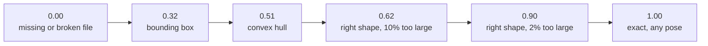

# Scoreboard

## How we are scored

```
score = 0.30 volume + 0.30 surface + 0.20 dimensions + 0.20 holes
```

| Part | Weight | Rule (from the kickoff) |
|---|---|---|
| Volume overlap | 30% | overall form, after rigid alignment |
| Surface match | 30% | surface position, checked at 0.5–10% of part size |
| Dimensions | 20% | 2% off loses 10%; 20% off loses everything |
| Holes | 20% | through-holes, counted exactly from CAD topology |

- Alignment by rotation and translation only. **No scaling, no mirroring.**
- A missing, broken or non-solid file scores 0 for that part.
- Three tiers by face count (simple ≤ 30, medium ≤ 200, complex above), weighted equally.
- The leaderboard keeps each team's **best** commit, so submit often.

## The ladder (organisers' medians over 14 parts)



Reading: size precision is worth as much as shape. A perfect shape 10% too large (0.62)
barely beats a shrink-wrap (0.51). The brief and `facts.json` give exact sizes, so
there is no excuse to lose these points.

## Our runs

| Run | Cases | Self-score | Local score | Leaderboard | Notes |
|---|---|---|---|---|---|
| fallback boxes only | 9 practice | — | — | **not submitted yet** | expected about 0.3 |
| base agent | 9 practice | **not run yet** | — | | needs the model endpoint |

Routine runs file themselves: `uv run python -m forge eval --tag <track>-<idea>` writes
`results/<time>-<tag>.json`, and `uv run python -m forge board` prints the table. After a
submission, add `"leaderboard": <value>` to that JSON file so the three numbers sit together.

Three different numbers, do not mix them up:

| Number | Needs | Trust |
|---|---|---|
| **Leaderboard** | a submission | the truth |
| **Local score** (`forge/score.py`) | the target STEP | our copy of their scorer; reads high (below) |
| **Self-score** (`forge/facts.py`) | only `facts.json` | exact for dimensions and holes, a hint for the rest |

## How close is our local scorer?

`uv run python scripts/calibrate_score.py`, medians over our 12 reference parts against
their slide (14 different parts):

| Damage | Ours | Theirs |
|---|---|---|
| exact part, any pose | 1.00 | 1.00 |
| 2% too large | 0.95 | 0.90 |
| 5% too long | 0.94 | 0.88 |
| 10% too large | 0.68 | 0.62 |
| convex hull | 0.60 | 0.51 |
| bounding box | 0.47 | 0.32 |

Same order, ours 0.05–0.15 higher. Part of that is the parts (ours are simpler, with
fewer holes), part is detail we guessed. Use the local score to compare two versions of
our agent, never to predict the leaderboard.

## The practice parts

| Case | Part | Faces | Tier | Through-holes | Notable |
|---|---|---|---|---|---|
| 1 | Camshaft retainer bracket | 17 | simple | 2 | planes and cylinders only |
| 2 | Engine poppet valve | 12 | simple | 0 | revolved; cones and tori |
| 3 | Crankshaft bushing | 9 | simple | 1 | revolved sleeve |
| 4 | Three-throw crankshaft | 178 | medium | 0 | 66 torus faces (fillets) |
| 5 | Engine cylinder head | 172 | medium | 15 | many holes, countersinks |
| 6 | Conical finned air filter | 122 | medium | 0 | 72 spline faces, radial pattern |
| 7 | Angled-bore mounting bracket | 628 | complex | 10 | 222 spline faces |
| 8 | Hydraulic pump main body | 306 | complex | 11 | cones, spheres |
| 9 | V6 engine block | 371 | complex | 6 | bores at 45° |

The hidden set is 9 different parts in the same format and tiers. Do not tune to these.
