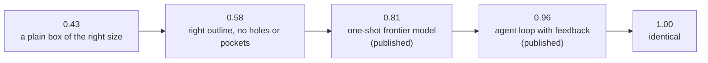

# Scoreboard

Numbers to aim at, and how to record ours.

## The ladder



The first two are measured on our own 12 parts. The published ones come from a different
benchmark, so read them as "what a good system reaches", not as directly comparable.

## Our runs

| Run | Input | Cases | IoU raw | IoU unit | Notes |
|---|---|---|---|---|---|
| base agent, first real run | text | 12 | **not run yet** | | needs an API key; Track A's first job |
| base agent, first real run | image | 12 | **not run yet** | | |

Do not edit this table for routine runs. Tag the eval and it files itself:

```bash
uv run python -m forge eval --tag c-fewshot
```

```bash
uv run python -m forge board
```

Update the table above only for milestones (new baseline, new best).

## Floors: what cheap mistakes cost

Mean IoU over the 12 reference parts after damaging the target (`forge sensitivity`).

| Damage | raw | center | unit | rot24 | icp |
|---|---|---|---|---|---|
| shifted by 5% of diagonal | 0.61 | 1.00 | 1.00 | 1.00 | 1.00 |
| rotated 5° | 0.78 | 0.78 | 0.73 | 0.73 | 1.00 |
| rotated 90° | 0.48 | 0.48 | 0.48 | 1.00 | 0.72 |
| wrong up axis | 0.16 | 0.16 | 0.16 | 1.00 | 0.65 |
| all dimensions +5% | 0.76 | 0.76 | 1.00 | 1.00 | 0.78 |
| all dimensions +20% | 0.36 | 0.36 | 1.00 | 1.00 | 0.38 |
| one dimension +10% | 0.79 | 0.79 | 0.68 | 0.68 | 0.80 |
| one dimension +30% | 0.60 | 0.60 | 0.40 | 0.41 | 0.60 |
| convex hull (no holes or pockets) | 0.58 | 0.58 | 0.58 | 0.58 | 0.57 |
| bounding box only | 0.43 | 0.43 | 0.43 | 0.43 | 0.41 |

How to read it: under `raw`, a wrong up axis (0.16) is worse than submitting a plain box
(0.43). Under `unit`, uniform size errors are free but a single wrong proportion is not.

Alignment modes: `raw` compares in absolute coordinates. `center` ignores position.
`unit` also ignores overall size. `rot24` also ignores which axis is which. `icp` fits
position and small rotations.

## Published reference points

| System | Input | Benchmark | Result | Source |
|---|---|---|---|---|
| Frontier model, single call | text | CADSmith, 100 prompts | median IoU 0.81, 95% build | [CADSmith](https://arxiv.org/html/2603.26512v1) |
| Same + planner, repair, numeric judge | text | same | median IoU 0.96, 99% build | same |
| Same + rendered views for the judge | text | same | median IoU 0.96, 100% build, far fewer disasters | same |
| Best frontier model | text | Text2CAD-Bench, easy tier | IoU 0.59, 11% fail to build | [Text2CAD-Bench](https://arxiv.org/html/2605.18430v1) |
| Best frontier model | text | Text2CAD-Bench, sweep/loft tier | IoU 0.25, ~70% fail to build | same |
| Best frontier model | 4 views | BenchCAD | IoU ~0.40 | [BenchCAD](https://arxiv.org/html/2605.10865v1) |
| Small model fine-tuned on the benchmark | 4 views | BenchCAD | IoU 0.75 | same |
| CAD-Recode | point cloud | DeepCAD | IoU 0.92 | [CAD-Recode](https://arxiv.org/pdf/2412.14042) |

Three things these say:

1. A feedback loop is worth about +0.15 IoU over a single call on text input.
2. Build failures dominate on hard shapes. Sweep, loft and shell are the usual culprits.
3. Image input is much harder than text for general-purpose models. That is where a
   team can separate itself.
