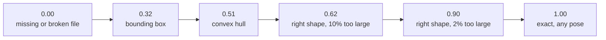

# Scoreboard

## How we are scored

```
score = 0.30 volume + 0.30 surface + 0.20 dimensions + 0.20 holes
```

| Part | Weight | Rule (from the kickoff) |
|---|---|---|
| Volume overlap | 30% | overall form, after rigid alignment |
| Surface match | 30% | surface position, checked at 0.5–10% of part size |
| Dimensions | 20% | 2% off loses 10%; 20% off loses everything |
| Holes | 20% | through-holes, counted exactly from CAD topology |

- Alignment by rotation and translation only. **No scaling, no mirroring.**
- A missing, broken or non-solid file scores 0 for that part.
- Three tiers by face count (simple ≤ 30, medium ≤ 200, complex above), weighted equally.
- The leaderboard keeps each team's **best** commit, so submit often.

## The ladder (organisers' medians over 14 parts)



Reading: size precision is worth as much as shape. A perfect shape 10% too large (0.62)
barely beats a shrink-wrap (0.51). The brief and `facts.json` give exact sizes, so
there is no excuse to lose these points.

## Our runs

| Run (11 Nov) | Parts built | Self-score mean | Leaderboard | Notes |
|---|---|---|---|---|
| bounding boxes only | 0 of 9 | — | **0.320** | commit `dcd0709`; matches the organisers' box median |
| base agent, Qwen3.8-27B, medium thinking | 3 of 9 | 0.315 | not submitted | 32 min; six parts lost to replies cut off by the token limit |
| `c/facts-driven`, same model | 4 of 9 | 0.418 | not submitted | 69 min (over the limit); three more parts built but were discarded by a timeout bug |
| hand-picked best candidate per part from that run | 7 of 9 | 0.724 | **0.658** | not reproducible by one run; measurement only |

In the self-score mean a fallback box counts as 0, although it earns 0.2–0.4 on the
leaderboard. Compare self-scores per part, not by the mean.

## Leaderboard, 12 Nov: what the submissions taught us

Per part, as the leaderboard reported them. Bold marks the best value seen for that part.

| Submission | Mean | 1 | 2 | 3 | 4 | 5 | 6 | 7 | 8 | 9 |
|---|---|---|---|---|---|---|---|---|---|---|
| boxes (11 Nov) | 0.320 | 0.332 | 0.272 | 0.413 | 0.361 | 0.432 | 0.298 | 0.216 | 0.342 | 0.211 |
| hand-picked model parts (11 Nov) | 0.658 | 0.862 | 0.879 | 0.997 | 0.731 | 0.709 | 0.633 | 0.216 | 0.687 | 0.211 |
| `01-no-model` | 0.847 | 0.949 | 0.944 | **0.997** | 0.851 | **0.849** | 0.610 | 0.700 | 0.936 | 0.784 |
| `06-no-model-depth` | 0.856 | 0.990 | 0.944 | **0.997** | 0.851 | 0.838 | 0.610 | 0.706 | 0.936 | 0.831 |
| `03-two-pass-qwen-think-cuts` (floor: 01) | 0.853 | 0.976 | **0.958** | **0.997** | **0.915** | 0.848 | 0.621 | 0.700 | 0.930 | 0.733 |
| `05-faces-qwen-think-cuts` (floor: 04) | **0.870** | **0.993** | 0.939 | **0.997** | 0.913 | 0.840 | **0.658** | **0.708** | **0.937** | **0.844** |

Best value per part, taken across submissions, averages 0.873. That is a ceiling for what
we have built so far, not a run we can reproduce.

What each comparison shows:

1. **Code alone beats yesterday's model-written parts by 0.19** (0.847 against 0.658),
   and does it in a minute, the same way every time. The five parts that `06` did not
   touch came back identical to three decimals.
2. **Dimensions and holes are banked.** Both are exact on all nine in every submission
   since `01`. Everything left to win is shape.
3. **Face carving is a real gain where a bore face is seen head-on**: part 1 +0.041,
   part 9 +0.047 (`06` against `01`).
4. **Volume closer to the target does not prove a cut is right.** Part 5 went from
   ×1.22 to ×1.13 of the target volume and lost 0.011. Our estimate predicted +0.04.
5. **A model-written body is worth it on a part made of plain cylinders and blocks**:
   part 4 (crankshaft) +0.064, and it repeated in a second run (0.915, 0.913). On part 1
   it gains less than the face carving does; on part 2 it is within ±0.015; on part 6 it
   gained 0.011 where our estimate predicted 0.13.
6. **Model cut lists swing both ways.** On the `01` floor: part 9 −0.051, part 8 −0.006,
   part 5 0, part 2 +0.014. On the carved floor: part 6 +0.048, part 9 +0.013, parts 5,
   7 and 8 +0.001 to +0.002. Not clearly good or bad; they are accepted on volume and
   silhouettes only, and point 4 says that is not enough.
7. **The estimate reads 0.06–0.07 low and cannot rank a model result against a hull.**
   It was right about the order of the no-model parts (6, 7 and 9 weakest) and wrong
   about parts 5, 6 and 9 whenever a cut or a model body was involved. Decide between
   configurations on leaderboard values.
8. **Where the remaining points are:** part 6 (0.66), part 7 (0.71), then 5, 9 and 4
   (0.84–0.91). Parts 1, 2, 3 and 8 are at 0.94–0.99 and have little left. Lifting 6 and
   7 to 0.85 would add 0.04 to the mean; nothing else we know of is that large.
9. **The model pass costs 20 minutes for about +0.014** over the no-model floor (0.870
   against 0.856), most of it from parts 4 and 6.

## Approaches filed on 12 Nov, with the local estimate

Each row is a folder in `bench/approaches/` with nine STEP files. **"Estimate" is local**,
not the leaderboard: `0.14 + 0.16 × holes + 0.62 × volume ratio × silhouette IoU`, fitted
on the 16 files of `bench/calibration/` (leave-one-out error 0.07 per part). Columns 1–9
are the estimate per practice part.

| Approach | Estimate | Leaderboard | 1 | 2 | 3 | 4 | 5 | 6 | 7 | 8 | 9 | Holes right |
|---|---|---|---|---|---|---|---|---|---|---|---|---|
| `00-boxes` | 0.327 | **0.320** | 0.40 | 0.31 | 0.37 | 0.34 | 0.45 | 0.36 | 0.19 | 0.28 | 0.25 | 3 of 9 |
| `00-qwen-picked` | 0.652 | **0.658** | 0.88 | 0.88 | 0.92 | 0.68 | 0.84 | 0.57 | 0.19 | 0.65 | 0.25 | 6 of 9 |
| `01-no-model` | 0.773 | not submitted | 0.88 | 0.86 | 0.92 | 0.83 | 0.80 | 0.49 | 0.61 | 0.87 | 0.70 | 9 of 9 |
| `02-two-pass-qwen-nothink` | 0.779 | not submitted | 0.88 | 0.86 | 0.92 | 0.88 | 0.80 | 0.49 | 0.61 | 0.87 | 0.70 | 9 of 9 |
| `03-two-pass-qwen-think-cuts` | 0.807 | not submitted | 0.90 | 0.91 | 0.92 | 0.88 | 0.81 | 0.62 | 0.61 | 0.89 | 0.73 | 9 of 9 |
| `04-no-model-faces` | 0.793 | not submitted | 0.91 | 0.86 | 0.92 | 0.83 | 0.85 | 0.49 | 0.61 | 0.87 | 0.80 | 9 of 9 |
| `05-faces-qwen-think-cuts` | 0.814 | not submitted | 0.91 | 0.88 | 0.92 | 0.88 | 0.85 | 0.56 | 0.65 | 0.87 | 0.80 | 9 of 9 |
| `06-no-model-depth` | 0.794 | not submitted | 0.91 | 0.86 | 0.92 | 0.83 | 0.85 | 0.49 | 0.62 | 0.87 | 0.80 | 9 of 9 |

- `00-boxes`: Bounding boxes (leaderboard 0.320 on 11 Nov)
- `00-qwen-picked`: Hand-picked model candidates of 11 Nov (leaderboard 0.658)
- `01-no-model`: Pass 1 only, no model call: visual hull or revolve from the eight views, bores from facts.json fitted to the through-hole count. 8 min wall clock.
- `02-two-pass-qwen-nothink`: Pass 1 + model body pass, Qwen3.8-27B, thinking off, 3 bodies per part. Model won only on parts 4 and 6. 632 s wall clock.
- `03-two-pass-qwen-think-cuts`: Pass 1 + model pass with thinking on (medium, 16k tokens), 2 bodies + 1 cut list per part. Model won on 1,2,4,5,6,8,9. 1691 s wall clock.
- `04-no-model-faces`: Pass 1 only, no model call: as 01 plus the space in front of every face a bore starts from removed (forge/layers.py). Files made inside the Docker image by the final code, as non-root: 52 s. Repeatable exactly.
- `05-faces-qwen-think-cuts`: As 04 plus the model pass with thinking on (medium, 16k tokens), 2 bodies + 1 cut list per part. Model won on 2,4,5,6,7,8 (cut lists on 5,6,7,8). 1275 s wall clock.
- `06-no-model-depth`: Pass 1 only, no model call: as 04 plus flat faces cut down to the depth read from the isometric views (open cavities, recessed levels). Files made inside the Docker image by the final code, as non-root: 68 s. Repeatable exactly. Same as 04 on eight practice parts; its value is on hollow parts (our enclosure: 0.68 -> 0.99 against the answer).

How far to trust the estimate:

- It reproduces the two means we know (0.327 against 0.320; 0.652 against 0.658), but
  those are the files it was fitted on. Per part it is off by up to 0.13 (part 5: 0.84
  against 0.709).
- Dimensions and holes in it are exact. The shape part is not: a hull matches every
  silhouette by construction, so for hulls the estimate is driven by the volume ratio.
- A model cut list raises it whenever volume comes off without a silhouette changing.
  That does not prove the cut is in the right place. Rows 03 and 05 may be flattered.
- Two runs of the same model settings differ by about 0.01 in the mean (part 6: 0.62 in
  one run, 0.56 in the next).

Wall-clock on Robin's laptop (15 cores): pass 1 alone 6 min (52 s inside the Linux
container); with the model pass, thinking off 10.5 min, thinking on 21–28 min. With the depth
sweep pass 1 takes 7 min on the laptop and 68 s in the container.

### True local score (our 12 reference parts, which have answers)

| Run | Mean score | Notes |
|---|---|---|
| bounding boxes | 0.499 | `scripts/bench_nomodel.py` |
| hull from silhouettes, no model | 0.921 | ten parts at 0.94–1.00; enclosure 0.68, elbow 0.53 (hollow) |
| hull from organiser-style renders | 0.920 | `scripts/bench_layers.py` |
| the same, plus the depth sweep with the plain-sight test | **0.949** | enclosure 0.682 → 0.991, flange 0.961 → 0.996, wheel 0.981 → 0.997; no part lower; elbow (a bent tube) still 0.53 |

These parts are simpler than the practice set and their facts carry no bore list, so
this measures the silhouette bodies only.

### Per part: self-score against the leaderboard (hand-picked set)

| Part | Tier | Box | Self-score | Leaderboard | Shape points earned (of 0.60) |
|---|---|---|---|---|---|
| 1 | simple | 0.332 | 0.989 | 0.862 | 0.46 |
| 2 | simple | 0.272 | 0.991 | 0.879 | 0.48 |
| 3 | simple | 0.413 | 1.000 | 0.997 | 0.60 |
| 4 | medium | 0.361 | 0.894 | 0.731 | 0.33 |
| 5 | medium | 0.432 | 0.980 | 0.709 | 0.32 |
| 6 | medium | 0.298 | 0.783 | 0.633 | 0.23 |
| 7 | complex | 0.216 | none built | 0.216 | — |
| 8 | complex | 0.342 | 0.880 | 0.687 | 0.29 |
| 9 | complex | 0.211 | none built | 0.211 | — |

"Shape points" = leaderboard minus the dimension and hole points our exact check gives.
Readings:

- Dimensions and holes (0.40) are essentially solved on every part that builds.
- The self-score reads 0.00–0.27 too high, and all of the gap is shape. Part 5 has total
  volume ×1.00 and still earns half the shape points: the right amount of material in
  the wrong place. The self-score cannot see that.
- Two parts that do not build cost about 0.10 of the mean.

The scored STEP files and the programs that built them are in `bench/calibration/`, with
the leaderboard number per part. Use them to test any new shape check: a good check
ranks these parts the way the leaderboard does.

Other teams on 11 Nov evening: one at 0.921 (probably a hosted frontier model), several
around 0.8 with open models.

Routine runs file themselves: `uv run python -m forge eval --tag <track>-<idea>` writes
`results/<time>-<tag>.json`, and `uv run python -m forge board` prints the table. After a
submission, add `"leaderboard": <value>` to that JSON file so the three numbers sit together.

Three different numbers, do not mix them up:

| Number | Needs | Trust |
|---|---|---|
| **Leaderboard** | a submission | the truth |
| **Local score** (`forge/score.py`) | the target STEP | our copy of their scorer; reads high (below) |
| **Self-score** (`forge/facts.py`) | only `facts.json` | exact for dimensions and holes, a hint for the rest |

## How close is our local scorer?

`uv run python scripts/calibrate_score.py`, medians over our 12 reference parts against
their slide (14 different parts):

| Damage | Ours | Theirs |
|---|---|---|
| exact part, any pose | 1.00 | 1.00 |
| 2% too large | 0.95 | 0.90 |
| 5% too long | 0.94 | 0.88 |
| 10% too large | 0.68 | 0.62 |
| convex hull | 0.60 | 0.51 |
| bounding box | 0.47 | 0.32 |

Same order, ours 0.05–0.15 higher. Part of that is the parts (ours are simpler, with
fewer holes), part is detail we guessed. Use the local score to compare two versions of
our agent, never to predict the leaderboard.

## The practice parts

| Case | Part | Faces | Tier | Through-holes | Notable |
|---|---|---|---|---|---|
| 1 | Camshaft retainer bracket | 17 | simple | 2 | planes and cylinders only |
| 2 | Engine poppet valve | 12 | simple | 0 | revolved; cones and tori |
| 3 | Crankshaft bushing | 9 | simple | 1 | revolved sleeve |
| 4 | Three-throw crankshaft | 178 | medium | 0 | 66 torus faces (fillets) |
| 5 | Engine cylinder head | 172 | medium | 15 | many holes, countersinks |
| 6 | Conical finned air filter | 122 | medium | 0 | 72 spline faces, radial pattern |
| 7 | Angled-bore mounting bracket | 628 | complex | 10 | 222 spline faces |
| 8 | Hydraulic pump main body | 306 | complex | 11 | cones, spheres |
| 9 | V6 engine block | 371 | complex | 6 | bores at 45° |

The hidden set is 9 different parts in the same format and tiers. Do not tune to these.
