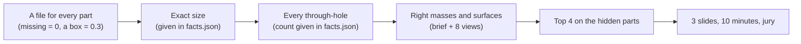
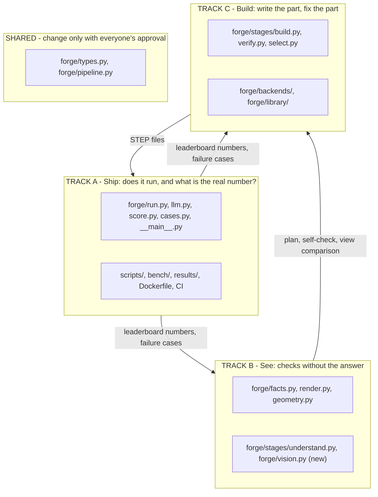
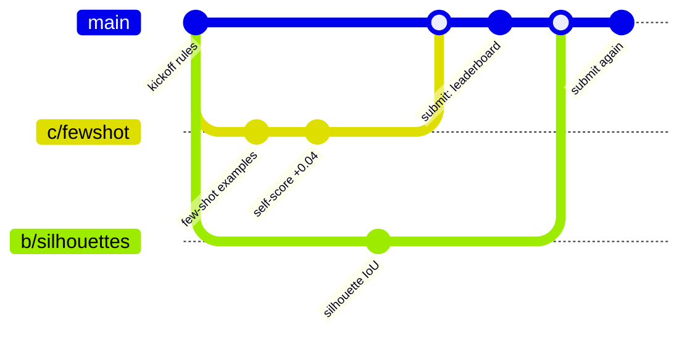
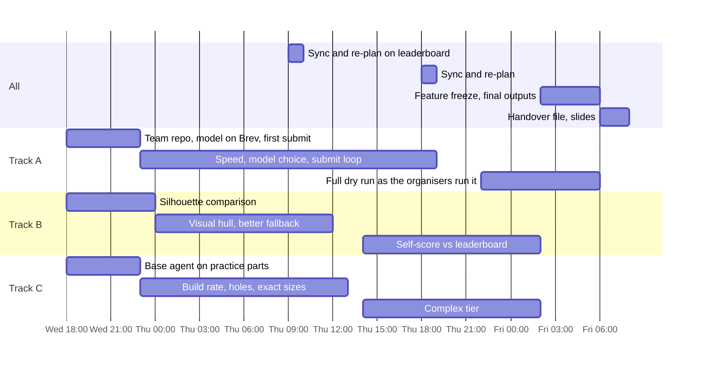

# Strategy

Updated after the kickoff (Wed 11 Nov). Code freeze is **Friday 08:00**.

## What changed at the kickoff

| We assumed | It is |
|---|---|
| a vague prompt or one image | a detailed brief with exact mm dimensions, **plus** 8 orthographic views, **plus** `facts.json` with the target's measured bounding box, volume, area and hole inventory |
| unknown metric, maybe pose-sensitive | 0.30 volume + 0.30 surface + 0.20 dimensions + 0.20 holes, after rigid alignment; pose is free, size and handedness are not |
| unknown engine | any tool, as long as the output is one STEP solid in mm named `test_case_<n>.stp` |
| unknown models | our own model behind an OpenAI-compatible endpoint, hosted on Brev (€250 credit) |
| unknown limits | 20 minutes for all nine parts, one RTX PRO 6000 (96 GB) inside their container |
| one final submission | live leaderboard during the event; best commit counts; final ranking on 9 hidden parts of the same kind |

## What winning takes now

40% of the score (dimensions and holes) can be checked exactly against `facts.json`
while the agent runs. Getting those right on every part comes before anything else.

## Three tracks

| | Track A — Ship | Track B — See | Track C — Build |
|---|---|---|---|
| Question | Does our image run in 20 minutes, and what does the leaderboard say? | How do we know a part is right without the answer? | Can the model write it, and fix it? |
| Number to move | leaderboard score; minutes per run | how well the self-score predicts the leaderboard | build rate; self-score per tier |
| First job | team repo from the template, model served on Brev, first submission | silhouette comparison between their views and ours | run the base agent on the 9 practice parts, sort the failures |
| Suits someone who likes | infrastructure, serving models, tooling | 3D vision, geometry | prompting, code generation |
| Brief | [A-ship.md](tracks/A-ship.md) | [B-see.md](tracks/B-see.md) | [C-build.md](tracks/C-build.md) |

### Why the old "Understand" track became "See"

The old Track B existed to turn a vague prompt into exact numbers. The organisers now
hand us the exact numbers, so that job is gone. Two real problems remain on the input
side, and both are about the views:

- **The brief is incomplete on complex parts.** Case 5 says "three shallow
  rounded-rectangular pockets" with no dimensions. Case 7 has 628 faces, 222 of them
  free-form; no brief can list them. The missing shape is only in the pictures.
- **Volume and area cannot prove the shape is right.** The views can: render our part
  with the same eight cameras and compare outlines.

## Decision: no trained network

A teammate proposed training a network: frozen VGGT image features, a transformer
decoder with learned queries, output N primitives of 12 numbers each (rotation,
translation, scale, shape exponents, existence), supervised by superquadrics fitted to
each object. It is a sound research design. For this competition we should not build it.

| Issue | Why it hurts here |
|---|---|
| Superquadrics are convex blobs with no holes | holes are 20% of the score, and 6 of the 9 practice parts have between 1 and 15 |
| A set of blobs is a coarse shape | the organisers' own number for a convex shrink-wrap is 0.51; surface match is checked down to 0.5% of part size |
| It reads only the images | the brief and `facts.json` give sizes to 0.01 mm; 2% size error already costs points |
| It needs data we do not have | thousands of mechanical parts rendered in this style with fitted primitives; today it overfits 24 objects with one layer |
| Time | under 40 hours, of which the network would need most for data and training before producing a first score |
| Still not a STEP solid | the blobs must be converted into one valid B-rep solid |

Run-time limits are not the problem; VGGT fits on the provided GPU.

**What to do with that expertise instead:** the useful part of the idea is "get coarse
3D shape from the views". With eight clean orthographic views and known cameras that
needs no training: carve a visual hull from the silhouettes. It has the exact size, it
keeps through-holes that are visible along a view axis, and it works on parts no
dataset contains. That is Track B's main line; see [B-see.md](tracks/B-see.md).

If the team still wants to try the network, cap it: one person, six hours, and it must
beat the visual hull on the leaderboard to continue.

## How we work in the repo

1. **`main` always works**: tests green, `scripts/main.py` runs.
2. **Short branches `<track>/<idea>`**, one idea each, pull request to merge, squash.
3. **Stay in your track's files.** Shared files need everyone's approval.
4. **Every merge to `main` in the team repo is a submission.** Track A decides when to
   merge. Outputs must be regenerated and committed with the code that made them.
5. **Tag every eval** (`--tag c-fewshot`), and write the leaderboard value into that
   result file once it is known.
6. **A change that does not move a number does not merge.**

## Timeline

## Still open: ask the organisers

1. **Where are the practice answers and the scorer?** The slides say the practice parts
   are "released with the answers" and the scorer is "shipped with the practice set".
   The template repo has neither: `example_outputs/` is three copies of an unrelated file.
2. **Will `facts.json` exist for the hidden parts?** The README says the hidden set is
   "in exactly this format", but the template's own loader does not read it. Our design
   leans on it, so confirm.
3. **20 minutes or one hour?** The slide says 1 h for nine parts, the README says 20
   minutes. We plan for 20.
4. **May the endpoint be a hosted commercial model**, or must it be one we serve on Brev?
5. **How strictly must a re-run reproduce our submitted outputs?** Model sampling is not
   fully repeatable. The README says a mismatch is "reviewed by hand".
6. **Does the container have internet access** during the hidden run, beyond our endpoint?

## Settled questions

| Question | Answer |
|---|---|
| Prompt enhancement? | Not needed: the brief is already precise. The plan stage now orders the build and lists what must be read from the views. |
| B-rep or a visual representation? | Output is B-rep (STEP), produced by running a program. Meshes and images are derived from it for checking. |
| Knowledge base? | Minor. `forge/library/` stays for standard shapes; add a helper only when a failing part needs it. |
| Iterative edit tasks? | Not part of this competition. |
| Which CAD engine? | Free choice. CadQuery stays unless a measured comparison beats it. |
