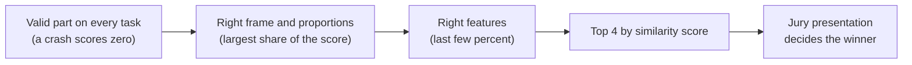
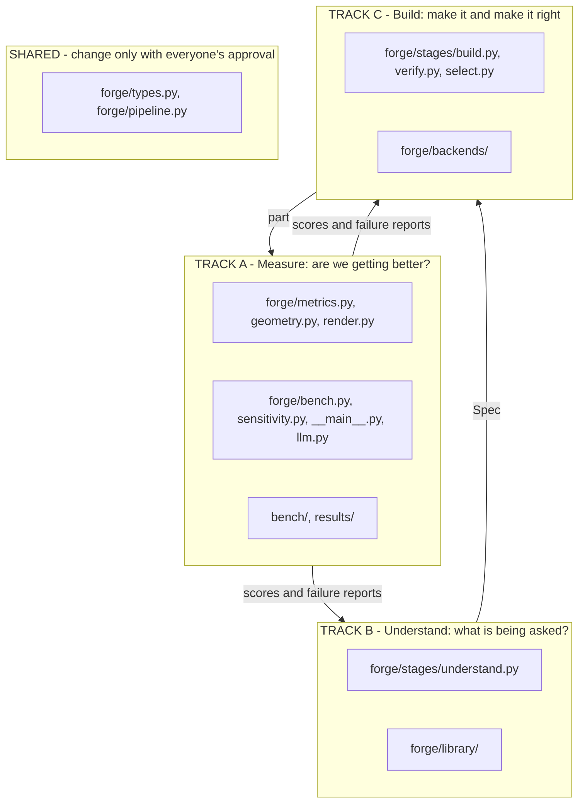
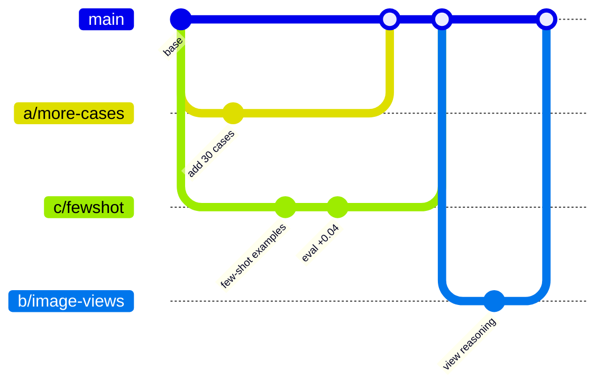
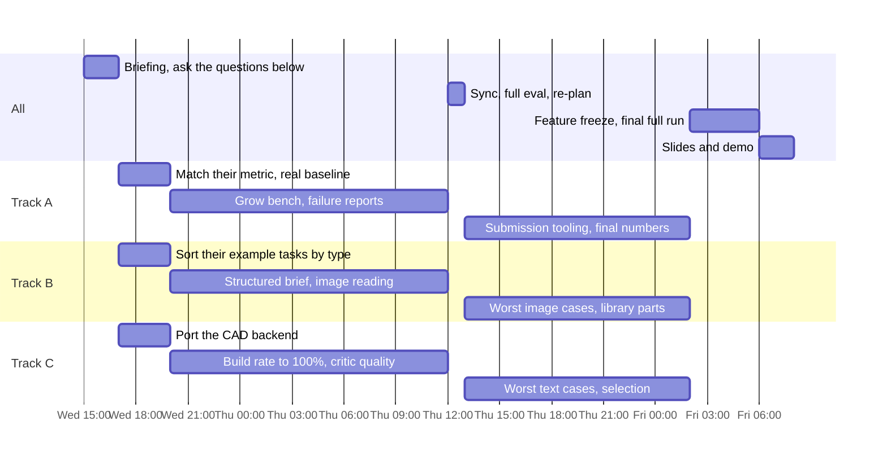
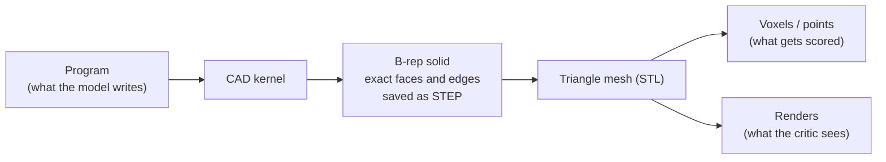

# Strategy

How three people win this in 39 hours without stepping on each other.

## What winning takes

Work the chain left to right. Do not polish features while tasks still crash.
The score only gets us into the final four; a clear story with numbers wins the jury.

## Three tracks, three sets of files

The problem splits along the question each person answers.

| | Track A — Measure | Track B — Understand | Track C — Build |
|---|---|---|---|
| Question | Is the number real, and is it going up? | What exactly is being asked? | Can we build it and catch our own mistakes? |
| Number to move | eval matches the organisers' score; cases in the bench | image-input IoU; envelope error | build rate; text-input IoU |
| First job at the briefing | reproduce their score locally | read their example tasks, sort them by type | port the CAD backend |
| Suits someone who likes | data, plots, tooling | vision, prompting, mechanical parts | code generation, agent loops |
| Brief | [A-measure.md](tracks/A-measure.md) | [B-understand.md](tracks/B-understand.md) | [C-build.md](tracks/C-build.md) |

Why this split holds up: B and C meet only at `Spec`, and C and A meet only at the
exported part. Each track can be tested alone. B can be judged by reading `spec.md`
against the target. C can be handed a hand-written perfect brief. A needs neither.

## How we work in the repo

1. **`main` always works.** Tests green, `forge eval` runs.
2. **Short branches named `<track>/<idea>`**, for example `c/fewshot`. One idea each.
3. **Pull request to merge.** Squash. The description states the score before and after.
4. **Stay in your track's files.** Then merges never conflict. Need something in another
   track's file? Ask its owner or open a small separate PR for it.
5. **Shared files** (`forge/types.py`, `forge/pipeline.py`) need all three to approve.
6. **Every eval run is tagged** (`--tag c-fewshot`) so it lands in `results/` as its own
   file. Nobody edits a shared results table by hand.
7. **A change that does not move the score does not merge**, however clever. Park it on
   its branch and write one line in your track brief about why it failed.

## Timeline

Every four hours, ten minutes together: each person says their number, what moved it,
and what is blocking them. Sleep in shifts; a tired person breaks `main`.

## Questions to ask at the briefing

1. Which similarity metric exactly, and is the part aligned or normalised before scoring?
2. Which output format: STEP, STL, the program, something else?
3. Which CAD engine or language, and may we use a different one if the output format matches?
4. How many hidden targets, and how are they split between text and image input?
5. For image input: one view or several, render or photo or drawing, are dimensions shown?
6. Is there a public validation set with targets we can score against ourselves?
7. How many submissions are allowed, and do we see our score after each?
8. What does a failed or invalid part score?
9. Is there a time or cost limit per task? Is the run live or do we upload results?
10. Are there multi-step tasks (build a part, then edit it)?
11. Which models and compute are provided, and may we bring our own API keys?
12. Are internet access and pretrained third-party models allowed?

## Decisions already taken, and why

### Do we need prompt enhancement?

Yes, and it is Track B's core job, with one caveat. We cannot add information the prompt
does not contain; the target is hidden. What we can do is make the model's guesses
explicit, consistent and conventional. That is what the brief does. Expect the largest
gain on short prompts and on image input, and almost none on prompts that already list
every dimension.

### B-rep or a visual representation?

Both, in different roles. We never choose between them.

- **B-rep** (boundary representation) is the exact description CAD systems use. A model
  cannot write one directly; the format is too long and too fragile. Research systems
  that generate B-rep directly are trained networks, which we cannot build in 39 hours.
- So the model writes a **program**, and the kernel turns it into B-rep for free. Our
  output is already industry-standard STEP.
- **Meshes, voxels and images** are how the result is scored and inspected. They are
  derived from the B-rep and never edited by hand.

### Do we need a knowledge base?

A small one. `forge/library/` holds tested generators for shapes defined by a standard:
gears now; threads, fastener heads and standard profiles are candidates. The model
calls them by name. Add a part only when a real task needs it.

### What about involute gears?

Expect one or two; they are the classic hard case. Two facts keep this cheap:

- The exact tooth curve barely affects an overlap score. A gear with straight-sided teeth
  and a true involute gear overlap almost completely. What moves the score is **tooth
  count, outer diameter, face width and bore**.
- The curve is solved once in `spur_gear()`. The remaining problem is reading those four
  numbers from the task.

From an image, the hard number is the tooth count; models count badly. Track B has this
as an open problem (crop and zoom, count along the rim, cross-check with pitch).

### What if they test iterative editing?

Ask at the briefing (question 10) and do not build it before then.

Our design already favours it: the state of a part is its **program**, and editing a
program is far easier than editing a mesh. `Task.base_code` is reserved for this. If the
edit builds on a part we generated, we still have its program. The hard variant is
being handed a foreign mesh or STEP file with no program; that needs reverse
engineering and would be a new work item for Track C.
