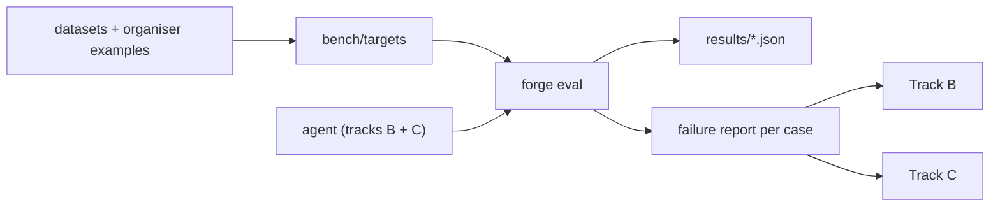

# Track A — Measure

**In plain words:** you make sure the team's number is real and tell the other two
where they are losing points. If the local score does not predict the organisers'
score, everyone optimises the wrong thing. You also own the plumbing to the outside
world: models, task files, submissions. You will have the numbers and plots, so you
lead the jury presentation.

## You own

`forge/metrics.py` `forge/geometry.py` `forge/render.py` `forge/bench.py`
`forge/sensitivity.py` `forge/__main__.py` `forge/llm.py` `bench/` `results/` `scripts/`

## Numbers you move

| Number | Now | Target |
|---|---|---|
| Real baseline score recorded | none | exists, text and image |
| Benchmark cases | 12, easy | 60+, a third of them hard, a third image-only |
| Local score vs organiser score, same parts | unknown | same ranking, within 0.02 |
| Time for a full eval | unmeasured | under 15 min |

## Backlog, in order

1. **Run the first real baseline.** `uv run python -m forge eval --tag a-baseline-text` and
   again with `--image`. Record both in `docs/SCOREBOARD.md`. Nothing else is meaningful
   until this exists.
2. **Per-stage numbers in eval.** Today eval scores only the chosen part. Also score
   (a) each candidate's first runnable version, (b) each candidate's final version,
   (c) the best candidate in hindsight. This yields three diagnostics the other tracks
   need: *critic gain* = b − a, *selection regret* = c − chosen, *build rate*. All the
   files are already under `runs/<case>/cand*/try*/`.
3. **Failure report.** One command that, for the worst N cases, puts target render,
   our render, `spec.md` and the scores side by side in one HTML or PNG. People fix what
   they can see.
4. **Grow the benchmark.** Pull cases with a target solid and a description. Aim for
   variety in *operations* (revolve, sweep, loft, shell, patterns, fillets) and in
   *prompt style* (fully dimensioned, vague, image-only). Keep a fixed 15-case `smoke`
   subset for quick runs and the full set for PRs.
5. **Match the organisers' metric** (first hours after the briefing). Take their example
   targets and their reported scores, run `forge score` in every mode, find the mode and
   resolution that reproduces them. Then make that the headline column and re-run
   `forge sensitivity` under it.
6. **Speed.** Parallelise eval across cases; cache target meshes; make `--only` and a
   `--subset smoke` flag cheap enough to run after every change.
7. **Model adapter.** New `LLM` subclass for whatever endpoint they provide. Check image
   input works; if their models cannot see images, tell Track B at once.
8. **Task loader and submission exporter.** Their format in, their format out.
9. **Variance.** Run the same config three times. If the spread is 0.03, a +0.02
   "improvement" is noise. Publish the spread so nobody merges noise.

## Search terms

volumetric IoU, voxel occupancy, Chamfer distance, F-score at threshold, Hausdorff
distance, normal consistency, invalidity rate, survivorship bias in CAD benchmarks,
ICP registration, PCA canonical pose, principal-axis alignment, point-to-mesh distance,
watertight mesh, signed distance field, B-rep topology metrics (face/edge count match).

Datasets: DeepCAD, Fusion 360 Gallery reconstruction set, ABC dataset, Text2CAD,
Text2CAD-Bench, CADPrompt, BenchCAD, GenCAD-Code, CAD-Recode, Mechanical Components
Benchmark (MCB), CADTests.

## Traps

- Averaging only over parts that built. A failure is a zero; `eval` already does this,
  keep it that way.
- Benchmark made only of our own easy parts. It will say everything works.
- Letting test cases leak into prompts as few-shot examples. Keep a held-out split and
  tell Track C which cases they may borrow from.
- Thin-walled parts swing wildly under IoU with tiny misalignment. Report them
  separately so they do not hide progress elsewhere.

## Lab notes

Append one line per experiment: date, idea, score before → after, kept or dropped.
