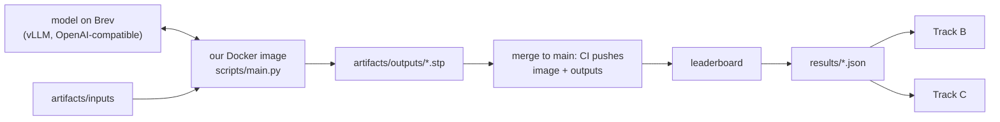

# Track A — Ship

**In plain words:** you make sure our agent runs the way the organisers will run it,
inside one hour, and you own the only number that counts: the leaderboard. You serve
the model, build the image, submit, and tell the other two what the leaderboard said.
You will have the numbers, so you lead the three slides.



## You own

`forge/run.py` `forge/llm.py` `forge/score.py` `forge/cases.py` `forge/__main__.py`
`scripts/` `bench/` `results/` `Dockerfile` `.github/` `pyproject.toml`

## Numbers you move

| Number | Now | Target |
|---|---|---|
| Leaderboard score | no submission | first one tonight, then every few hours |
| Wall-clock for 9 parts | unmeasured | under 15 min on one RTX PRO 6000 |
| Model endpoint | none | up, public, stable until judging ends |
| Local score vs leaderboard | ours reads 0.05–0.15 high | same ranking of our own versions |

## Backlog, in order

1. **Check the submission path.** This repo carries the organisers' `.ci/push.sh`, the
   `submit` CI job and the practice inputs, so a push to `main` submits. The repo
   variables are set; the secrets must be loaded once by the owner
   (`gh secret set -f team-g.secrets.env`). Watch the first `submit` job go green.
2. **Submit the floor first.** `artifacts/outputs/` holds a bounding-box solid for all
   nine parts. Merge it and read the leaderboard. This proves the whole path and tells
   us what a box really scores.
3. **Serve a model on Brev** with vLLM and open the port (README: "Hosting an LLM").
   It must accept images. Pick by measuring, not by reputation: run two or three
   candidates on the practice parts and compare self-score and time. Search terms below.
4. **Docker image details.** Our `Dockerfile` installs the system libraries CadQuery
   needs and has run as non-root on arm64. Still to check: the `linux/amd64` build that
   CI pushes, with the exact `docker run --user` command from the organisers' README.
5. **Fit in one hour.** Measure where time goes. Levers: `FORGE_WORKERS`,
   `FORGE_CANDIDATES`, `FORGE_ROUNDS`, image resolution, `max_tokens`, vLLM batching.
   Spend more candidates on complex parts and fewer on simple ones.
6. **Reproducibility.** After freeze the organisers re-run our image on the practice
   parts and compare with what we submitted. Fix seeds and sampling settings, and check
   two runs of our own agree closely.
7. **Leaderboard log.** After each submission write the score into the matching
   `results/*.json` (`"leaderboard": 0.xx`). Per-part numbers if the board shows them.
8. **Tighten `forge/score.py`** if answers appear (open question 1): fit the guessed
   details until our number matches the leaderboard on the same files.
9. **Handover at freeze:** `<team>.env` with `OPENAI_BASE_URL`, `OPENAI_API_KEY`,
   `OPENAI_MODEL` and every `FORGE_*` we set. Check the endpoint from a machine that is
   not tunnelled. Keep the Brev instance up until judging ends and watch the credit.
10. **More reference cases with answers** in `bench/parts/`, shaped like the practice
    parts: revolved parts, blocks with many holes, angled bores.

## Search terms

vLLM serve vision-language model, OpenAI-compatible chat completions with image_url,
vLLM guided decoding, vLLM seed and temperature reproducibility, tensor parallel, AWQ /
FP8 quantisation, throughput vs latency under concurrent requests, NVIDIA Brev expose
port, open-weight vision-language models for code generation (check current leaderboards:
Qwen VL family, InternVL, Llama vision, Gemma, GLM-V), reasoning models served by vLLM.

Scoring: volumetric IoU, F-score at threshold, ICP with multiple initialisations,
principal-axis alignment, Euler characteristic and genus of a closed surface.

## Traps

- A merge to `main` that changes code but not the committed outputs. The re-run will
  not match.
- Putting a personal provider key in the Dockerfile. The image is readable by the
  organisers.
- Finding out at 07:30 on Friday that the image does not start as non-root.
- Letting the Brev instance stop: its address may change, and the handover file breaks.

## Lab notes

Append one line per experiment: date, idea, number before → after, kept or dropped.

- 11 Nov: boxes only → leaderboard 0.320. Kept as the floor.
- 11 Nov: Qwen3.8-27B on vLLM with speculative decoding (`scripts/serve_vllm.sh`): 26 → 71 tokens/s per request. Kept.
- 11 Nov: default (maximum) thinking: plan call used 16,000 tokens and wrote nothing. Medium: 316 s. Off: 186 s. Use off or low for everything except perhaps the plan.
- 11 Nov: 27 parallel requests with 32,000-token replies saturate the card; calls pass the 15-minute timeout. Use fewer candidates and a smaller token limit.
- 12 Nov: two passes (no-model part first, model second), best file always on disk, plan call removed: 69 min and 4 of 9 written → 6 min (no model) or 28 min (model, thinking on), 9 of 9 written. Kept (`a/two-pass`).
- 12 Nov: model pass, thinking off, 3 bodies per part: estimate 0.773 → 0.779, 10.5 min. Thinking on (medium, 16,000 tokens), 2 bodies + 1 cut list: 0.807, 28 min; several calls returned nothing after 16,000 thinking tokens. Not submitted.
- 12 Nov: today's tasks are A1–A5 in `docs/PLAN.md`.
- 12 Nov: T5 with `nvidia/GLM-5.3-Flash-FP4-Local` (320B, 2x RTX PRO 6000 `homely-white-cattle`, $14/h, `scripts/serve_glm53.sh`), same code as 14, 3 bodies per part. All numbers are the local estimate, nothing submitted. Thinking on, effort low, 16,000 tokens (`runs/glm53`, `runs/glm53-2`): estimate 0.849 and 0.829 against 0.808 without a model; a model body chosen on 4, 6, 7 and on 4, 5, 6; best body on 5: 0.90, on 7: 0.835 and 0.77 (27B about 0.57), on 6: 0.72 and 0.67; ran at first try 16 and 15 of 21, right envelope 12 of 21. But 14–15 replies per run used all 16,000 tokens thinking and returned nothing (part 9: no program in six of six), and the model pass took 1,070 and 1,435 s (27B: 70 s). Thinking off through a patched template (`runs/glm53-nothink`): the model reasons in the answer instead, 24 replies cut at 6,000 tokens, ran at first try 12 of 21, estimate 0.808, a body chosen on 4 and 6 only; worse than the 27B. Pass 1 took about 620 s on the laptop in all three runs (usually 270–300 s) and stopped parts 5, 6 or 7 at 600 s. Dropped for the submission: too slow and too erratic as the pipeline stands, and the credit does not cover judging. Server: weights on the local NVMe (root disk writes 131 MB/s), ready in 7–11 minutes.
- 12 Nov: T5, Qwen3.8-Flash-Next FP4-Local (nvidia, 1x RTX PRO 6000, n-gram table on CPU, `scripts/serve_flashnext.sh`) against Qwen3.8-27B, same code and settings as 12, thinking off. Bodies run at first try 18/21 (27B 16–19), right envelope 8/21 (8–13), volume within 10% 14/21 (12–19). A model body was chosen on 4, 5 and 6 (27B: 4 and 6); best body estimate on 5: 0.899 vs no-model 0.846 (27B best 0.43–0.74); 7: 0.653 (27B 0.56–0.57) and 9: 0.775 (27B 0.57), both refused for outer dimensions. Model pass 163 s. Estimate 0.803 → 0.828 (one run, estimate only). Filed as `15-flashnext-bodies` (13 was taken on main). Second run on the code of 14 (`runs/flashnext-pockets`): model body on part 4 only, part 5 best 0.785, mean 0.805; not filed.
- 12 Nov: Flash-Next, 6 bodies per part, code of 14, run on the GPU instance itself (`~/forge/runs/flashnext-6` on broken-bronze-swordfish; 16 cores, pass 1 459 s, model pass 398 s, 857 s in all). Right envelope at first try 14/42; 15 bodies refused for outer dimensions, 7 by the edge veto. Better bodies than the no-model part existed on 2 (0.905 vs 0.863) and 9 (0.836 vs 0.801) but were refused; chosen on 4 and 6 only; mean estimate 0.811. Leaderboard of 15 (Flash-Next, 3 bodies): 0.875 vs 0.871 for 12; only part 6 moved (0.685 → 0.712). Part 5 scored 0.838 in both although the solids differ by 9% in volume. Not filed.
- 12 Nov evening, leaderboard: 15 (Flash-Next, 3 bodies) 0.875; 16 (teammate, no model, shell step) 0.861; 17 (Flash-Next, 6 bodies, envelope fill, code before the shell) 0.869; 18 (same on the code with the shell) 0.869. Best stays 14 (27B, pockets, no shell): 0.877. Per part: the fill let a Flash-Next body through on 7 that scored 0.708 against 0.755 for the pocket part, and on 9 one that scored 0.837 against 0.831; the shell scored 0.600/0.602 on 6 against 0.685 (grooved) and 0.712 (hollow cone, one lucky draw). Part 4's model body gives +0.06 with either model. Decision: shell off (FORGE_SHELL_VOL=99), fill off, Flash-Next brings no reliable gain over the 27B.
- 12 Nov night, P0 (branch `a/facts-from-brief`): the organisers' extended practice README says hidden parts come with no `facts.json`; without it we wrote nothing (pass 1 and the box both need the bounding box). Now `forge/brief.py` rebuilds the facts from `description.md`: bounding box, volume and through-hole count from the Envelope line (20 distinct briefs, 9 practice + 11 more extended: 20/20 each), bores from the feature bullets by rules (146 real bores: 132 on the right axis line with the right diameter, 89 with the midpoint within 1 mm, 119 with the length within 1 mm, 14 missed, 2 "false" that are the two bores part 5's facts count but do not list; `scripts/brief_check.py`). Never written: surface area, faces. No model, nine practice parts, both scored against the real facts (`scripts/rescore.py`, local estimate): real facts 0.801 (`runs/p0-real`) → brief only 0.797 (`runs/p0-main-nofacts`, through `scripts/main.py` on a copy of the inputs without `facts.json`, nine valid files, 619 s). Per part equal except 5 (0.846 → 0.835: the brief gives its bores' depth but not which face they start from, so the faces-at-bore-mouths step is skipped) and 7 (0.658 → 0.633: holes 0.9, the top boss bore has no Z in the brief). Ten extended parts never seen, through `main.py` without facts: ten files, no crash, 643 s; estimate against their real facts 0.606 against 0.597 with their facts (`runs/p0-ext-nofacts`, `runs/p0-ext-facts`). Kept. `FORGE_IGNORE_FACTS=1` builds from the brief even where facts.json exists (testing); not set in the Dockerfile. `FORGE_BRIEF_LLM=1` adds one text call per task for bores the rules missed, each checked against the numbers in the brief; off by default because the endpoint was down and it could not be measured.
- 13 Nov, v6 (branch `a/v6` = `a/facts-from-brief` + `c/exact-programs` + the judge; not pushed). One merge conflict (`forge/stages/build.py: floor_note`, the same fix on both sides; P0's kept). Judge in `forge/stages/select.py: Judge`: exact program passing the gate > model body (margin, edge veto, outer dimensions, as before) > hull > box; `forge/pipeline.py` only wires generators to it. `forge/run.py`: exact programs now run on every part, `FORGE_SKIP_ABOVE` spares a part the bodies only. Every exact program gets a verdict under the strict and the relaxed rule whichever is active; `<work>/run_summary.json` and the end of the log give the tier per part and what each rule would have chosen. `run_exact` keeps a version that passes the gate over one with a higher fidelity that fails. 63 tests pass. No model, nine practice parts, shell off (`FORGE_SHELL_VOL=99`), local estimate against the real facts: P0 0.8008 → v6 0.8008, all nine parts the same source and the same estimate to four decimals (`runs/v6-nomodel`); from the brief alone (`FORGE_IGNORE_FACTS=1`) 0.7972, P0 0.797 (`runs/v6-nomodel-brief`). Wall 1633 s against 1136 s: the machine was shared with the tests, not a code change in pass 1. NOT run against the model: no number for the exact path yet. Extended set in `bench/extended` (20 MB, facts kept apart), `scripts/prep_extended.py`, `scripts/score_extended.py`, `docs/EXTENDED_RUN.md`; smoke run on two extended parts without facts and without a model: both files valid, estimate 0.916 and 0.915 against the real facts. `scripts/gpu_session.sh` starts the instance, waits for the server, checks the tunnel, runs the commands and always stops the instance (dry-run with stubbed brev/ssh/curl: normal end, missing container, failing command, Ctrl-C, kill, stop rate-limited twice, stop never accepted (exit 97 and a loud line), missing env file (instance never started)).
- 13 Nov, the GPU session for v6 (one command; not run yet). Estimated, not measured: boot 5 to 8 min, probe 20 to 30 min, full nine 30 to 45 min, so 60 to 85 min and about $5 to $7 at $4.84/h; `GPU_MAX_MIN=100` ends it at $8.07 whatever happens.
  ```bash
  V6='FORGE_THINKING=off FORGE_CANDIDATES=3 FORGE_CARVE=0 FORGE_MODEL_MARGIN=0.02 FORGE_EDGE_VETO=0.015 FORGE_SHELL_VOL=99 FORGE_WORKERS=9 FORGE_BUDGET_S=3000 FORGE_LLM_TIMEOUT_S=600 FORGE_IGNORE_FACTS=1'
  GPU_MAX_MIN=100 nohup scripts/gpu_session.sh \
    "$V6 FORGE_BUDGET_S=1800 FORGE_EXACT=3 FORGE_EXACT_ROUNDS=3 FORGE_BRIEF_LLM=1 uv run python -m forge eval --inputs artifacts/inputs --only test_case_4 test_case_6 -o runs/v6-probe --tag a-v6-probe > runs/v6-probe.log 2>&1" \
    "$V6 FORGE_EXACT=2 FORGE_EXACT_ROUNDS=3 uv run python -m forge eval --inputs artifacts/inputs -o runs/v6-full --tag a-v6-full > runs/v6-full.log 2>&1" \
    > runs/gpu-session.log 2>&1 &
  # afterwards, with the real facts (do not set FORGE_IGNORE_FACTS here):
  uv run python scripts/rescore.py runs/v6-full/outputs runs/v6-nomodel
  uv run python scripts/save_approach.py 20-v6-exact runs/v6-full/outputs "v6: exact programs (2 per part, 3 rounds) > bodies > hull, facts from the brief, 27B"
  ```
  The estimate `forge eval` prints in these runs is against the facts read from the brief; the tiers and both verdicts are in `runs/v6-*/work/run_summary.json`.
- 13 Nov 03:15: v6 full GPU session (`FORGE_EXACT=2`, 3 rounds, brief facts, 27B). It failed and nothing is filed. Smoke curl with `reasoning_effort` worked at 03:26. Pass 1 (no model) took 628 s (test_case_6 hit the 600 s cap). Then all 45 model calls (27 bodies, 18 exact) failed within 8 s with `APIConnectionError: Connection error.`, so every part is the hull (brief facts). Local estimate, real facts: 0.794, against 0.801 for `runs/v6-nomodel`. Session 22 min, about $1.77; instance stopped. Likely cause: two stale tunnel loops from 12 Nov (`sh -c while true; do ssh -N ... -L 8000:...`, PIDs 18490 and 54460, children from 02:05) were fighting over port 8000 with the script's own tunnel. Kill them before the next session. Also make the full run check `/models` right before pass 2, so a dead tunnel does not quietly turn into a no-model run.
- 13 Nov 04:08: v6 full GPU session, second try (`runs/v6-full2`, same command, `GPU_MAX_MIN=75`). Fixes first (commit `b100250` + the tunnel fix after it): `forge/llm.py` retries connection errors and 502/503/504 with backoff for up to `FORGE_LLM_RETRY_S` (180) s inside the call's deadline; `forge/run.py` checks `OPENAI_BASE_URL/models` right before the model pass, waits up to `FORGE_ENDPOINT_WAIT_S` (300) s, then goes on with a loud line; `scripts/gpu_session.sh` kills stale `ssh -N ... 8000` tunnels and loops, owns one reconnecting tunnel loop and a `/models` watchdog every 60 s. Real cause of the 03:37 failure, found live: brev's ssh config has `ControlMaster auto`, `ControlPersist 10m`, so `ssh -N -L 8000:...` hands the forward to the shared mux master and exits 0; the forward dies with the master 10 min after the last ssh (smoke curl 03:26, failures 03:37). In this session the loop re-added the forward every 3 s, which kept the master alive; the script now runs the tunnel with `-o ControlMaster=no -o ControlPath=none` and closes any old master first (not yet exercised on the real instance). Result: 0 connection errors, 0 retries, watchdog never failed; 48 exact programs written (2 per part, up to 3 rounds), 60 body tries; 16 replies cut off at the token cap with no answer (the log prints FORGE_MAX_TOKENS=6000 even for exact calls, so which path is unclear). Run 2941 s (pass 1 628 s, part 6 hit its cap). Session 59 min, about $4.76; first `brev stop` left it STOPPING for 7 min, a second `brev stop` gave STOPPED. Sources: exact 1 (part 1, strict and relaxed admit, volume x0.999, worst view 0.989; render matches all eight views), body 2 (parts 4, 6), hull 6. No part where only the relaxed rule admits, so no relaxed variant. Exact near-misses: part 3 both programs volume x1.000, worst view 0.995, refused only because the hull is as faithful (0.998); parts 2 (0.927 worst view), 5 (0.769), 9 (0.804) below the 0.965 bar; 4, 6, 7, 8 far off (volume x1.2 to x3.2, wrong holes). Local estimate, real facts: 0.812 against 0.801 for `runs/v6-nomodel` (part 4 0.825 → 0.881, part 6 0.516 → 0.594, part 5 0.846 → 0.835 and 7 0.658 → 0.633 from brief facts, part 1 0.914 both). Filed `20-v6-exact`; not submitted.
- 13 Nov 05:45: freeze checks of `a/v6` (with `origin/main` up to `b274d27` merged in: the star step and teammates' approaches; it had moved past `fbc3015`). Dockerfile line gets `FORGE_EXACT=0` written out. `docker build` ok; in the image, as CI runs it, 63 tests pass. End to end in the image as uid 1000, read-only root, practice inputs with every `facts.json` deleted, no model: nine STEP files, all from the hull tier, 615 s (pass 1 hits its 600 s cap on parts 1 and 2; run alongside the CI test container); `--cpus 4` alone: nine files, 615 s, same per-part estimates (0.914 0.863 0.915 0.825 0.835 0.605 0.637 0.870 0.801, against the facts rebuilt from the brief), part 2 at the cap. `forge check` against the real facts: parts 1 to 3 dims and holes 1.00. Dead endpoint (`OPENAI_BASE_URL=http://127.0.0.1:9/v1`, model pass on, `--cpus 4`): nine files, 1077 s wall (pass 1 616 s, endpoint wait 300 s, model calls fail after their 180 s retries), all hull; under the 1-hour limit, so the wait and retry defaults stay. Memory: pass-1 subprocesses take about 0.9-1.0 GB each and there are 9; two runs at once in Docker's 8 GB VM got 7 parts OOM-killed (`dmesg`), and those parts fell back to weaker files (part 5 0.835 → 0.654). If the organisers' container has less than about 10 GB, lower `FORGE_WORKERS`. Submission staged: `20-v6-exact` outputs in `artifacts/outputs` (made with `FORGE_EXACT=2` before the star step was merged; not reproduced byte for byte by the image).
