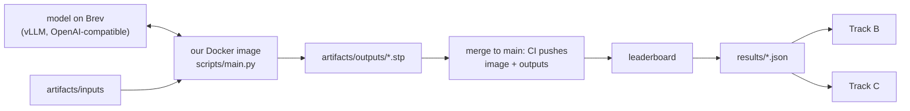

# Track A — Ship

**In plain words:** you make sure our agent runs the way the organisers will run it,
inside one hour, and you own the only number that counts: the leaderboard. You serve
the model, build the image, submit, and tell the other two what the leaderboard said.
You will have the numbers, so you lead the three slides.

## You own

`forge/run.py` `forge/llm.py` `forge/score.py` `forge/cases.py` `forge/__main__.py`
`scripts/` `bench/` `results/` `Dockerfile` `.github/` `pyproject.toml`

## Numbers you move

| Number | Now | Target |
|---|---|---|
| Leaderboard score | no submission | first one tonight, then every few hours |
| Wall-clock for 9 parts | unmeasured | under 15 min on one RTX PRO 6000 |
| Model endpoint | none | up, public, stable until judging ends |
| Local score vs leaderboard | ours reads 0.05–0.15 high | same ranking of our own versions |

## Backlog, in order

1. **Check the submission path.** This repo carries the organisers' `.ci/push.sh`, the
   `submit` CI job and the practice inputs, so a push to `main` submits. The repo
   variables are set; the secrets must be loaded once by the owner
   (`gh secret set -f team-g.secrets.env`). Watch the first `submit` job go green.
2. **Submit the floor first.** `artifacts/outputs/` holds a bounding-box solid for all
   nine parts. Merge it and read the leaderboard. This proves the whole path and tells
   us what a box really scores.
3. **Serve a model on Brev** with vLLM and open the port (README: "Hosting an LLM").
   It must accept images. Pick by measuring, not by reputation: run two or three
   candidates on the practice parts and compare self-score and time. Search terms below.
4. **Docker image details.** Our `Dockerfile` installs the system libraries CadQuery
   needs and has run as non-root on arm64. Still to check: the `linux/amd64` build that
   CI pushes, with the exact `docker run --user` command from the organisers' README.
5. **Fit in one hour.** Measure where time goes. Levers: `FORGE_WORKERS`,
   `FORGE_CANDIDATES`, `FORGE_ROUNDS`, image resolution, `max_tokens`, vLLM batching.
   Spend more candidates on complex parts and fewer on simple ones.
6. **Reproducibility.** After freeze the organisers re-run our image on the practice
   parts and compare with what we submitted. Fix seeds and sampling settings, and check
   two runs of our own agree closely.
7. **Leaderboard log.** After each submission write the score into the matching
   `results/*.json` (`"leaderboard": 0.xx`). Per-part numbers if the board shows them.
8. **Tighten `forge/score.py`** if answers appear (open question 1): fit the guessed
   details until our number matches the leaderboard on the same files.
9. **Handover at freeze:** `<team>.env` with `OPENAI_BASE_URL`, `OPENAI_API_KEY`,
   `OPENAI_MODEL` and every `FORGE_*` we set. Check the endpoint from a machine that is
   not tunnelled. Keep the Brev instance up until judging ends and watch the credit.
10. **More reference cases with answers** in `bench/parts/`, shaped like the practice
    parts: revolved parts, blocks with many holes, angled bores.

## Search terms

vLLM serve vision-language model, OpenAI-compatible chat completions with image_url,
vLLM guided decoding, vLLM seed and temperature reproducibility, tensor parallel, AWQ /
FP8 quantisation, throughput vs latency under concurrent requests, NVIDIA Brev expose
port, open-weight vision-language models for code generation (check current leaderboards:
Qwen VL family, InternVL, Llama vision, Gemma, GLM-V), reasoning models served by vLLM.

Scoring: volumetric IoU, F-score at threshold, ICP with multiple initialisations,
principal-axis alignment, Euler characteristic and genus of a closed surface.

## Traps

- A merge to `main` that changes code but not the committed outputs. The re-run will
  not match.
- Putting a personal provider key in the Dockerfile. The image is readable by the
  organisers.
- Finding out at 07:30 on Friday that the image does not start as non-root.
- Letting the Brev instance stop: its address may change, and the handover file breaks.

## Lab notes

Append one line per experiment: date, idea, number before → after, kept or dropped.

- 11 Nov: boxes only → leaderboard 0.320. Kept as the floor.
- 11 Nov: Qwen3.8-27B on vLLM with speculative decoding (`scripts/serve_vllm.sh`): 26 → 71 tokens/s per request. Kept.
- 11 Nov: default (maximum) thinking: plan call used 16,000 tokens and wrote nothing. Medium: 316 s. Off: 186 s. Use off or low for everything except perhaps the plan.
- 11 Nov: 27 parallel requests with 32,000-token replies saturate the card; calls pass the 15-minute timeout. Use fewer candidates and a smaller token limit.
- 12 Nov: two passes (no-model part first, model second), best file always on disk, plan call removed: 69 min and 4 of 9 written → 6 min (no model) or 28 min (model, thinking on), 9 of 9 written. Kept (`a/two-pass`).
- 12 Nov: model pass, thinking off, 3 bodies per part: estimate 0.773 → 0.779, 10.5 min. Thinking on (medium, 16,000 tokens), 2 bodies + 1 cut list: 0.807, 28 min; several calls returned nothing after 16,000 thinking tokens. Not submitted.
- 12 Nov: today's tasks are A1–A5 in `docs/PLAN.md`.
- 12 Nov: T5, Qwen3.8-Flash-Next FP4-Local (nvidia, 1x RTX PRO 6000, n-gram table on CPU, `scripts/serve_flashnext.sh`) against Qwen3.8-27B, same code and settings as 12, thinking off. Bodies run at first try 18/21 (27B 16–19), right envelope 8/21 (8–13), volume within 10% 14/21 (12–19). A model body was chosen on 4, 5 and 6 (27B: 4 and 6); best body estimate on 5: 0.899 vs no-model 0.846 (27B best 0.43–0.74); 7: 0.653 (27B 0.56–0.57) and 9: 0.775 (27B 0.57), both refused for outer dimensions. Model pass 163 s. Estimate 0.803 → 0.828 (one run, estimate only). Filed as `15-flashnext-bodies` (13 was taken on main). Second run on the code of 14 (`runs/flashnext-pockets`): model body on part 4 only, part 5 best 0.785, mean 0.805; not filed.
- 12 Nov: Flash-Next, 6 bodies per part, code of 14, run on the GPU instance itself (`~/forge/runs/flashnext-6` on broken-bronze-swordfish; 16 cores, pass 1 459 s, model pass 398 s, 857 s in all). Right envelope at first try 14/42; 15 bodies refused for outer dimensions, 7 by the edge veto. Better bodies than the no-model part existed on 2 (0.905 vs 0.863) and 9 (0.836 vs 0.801) but were refused; chosen on 4 and 6 only; mean estimate 0.811. Leaderboard of 15 (Flash-Next, 3 bodies): 0.875 vs 0.871 for 12; only part 6 moved (0.685 → 0.712). Part 5 scored 0.838 in both although the solids differ by 9% in volume. Not filed.
- 12 Nov evening, leaderboard: 15 (Flash-Next, 3 bodies) 0.875; 16 (teammate, no model, shell step) 0.861; 17 (Flash-Next, 6 bodies, envelope fill, code before the shell) 0.869; 18 (same on the code with the shell) 0.869. Best stays 14 (27B, pockets, no shell): 0.877. Per part: the fill let a Flash-Next body through on 7 that scored 0.708 against 0.755 for the pocket part, and on 9 one that scored 0.837 against 0.831; the shell scored 0.600/0.602 on 6 against 0.685 (grooved) and 0.712 (hollow cone, one lucky draw). Part 4's model body gives +0.06 with either model. Decision: shell off (FORGE_SHELL_VOL=99), fill off, Flash-Next brings no reliable gain over the 27B.
