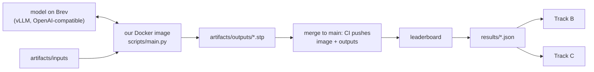

# Track A — Ship

**In plain words:** you make sure our agent runs the way the organisers will run it,
inside 20 minutes, and you own the only number that counts: the leaderboard. You serve
the model, build the image, submit, and tell the other two what the leaderboard said.
You will have the numbers, so you lead the three slides.

## You own

`forge/run.py` `forge/llm.py` `forge/score.py` `forge/cases.py` `forge/__main__.py`
`scripts/` `bench/` `results/` `Dockerfile` `.github/` `pyproject.toml`

## Numbers you move

| Number | Now | Target |
|---|---|---|
| Leaderboard score | no submission | first one tonight, then every few hours |
| Wall-clock for 9 parts | unmeasured | under 15 min on one RTX PRO 6000 |
| Model endpoint | none | up, public, stable until judging ends |
| Local score vs leaderboard | ours reads 0.05–0.15 high | same ranking of our own versions |

## Backlog, in order

1. **Create the team repo from the organisers' template** (private), add teammates, load
   `<team>.vars.env` and `<team>.secrets.env` into GitHub Actions as the README says.
   Then bring this code in: `forge/`, `scripts/main.py` (replaces theirs, same
   interface), `tests/`, docs, and merge `pyproject.toml` (ours needs cadquery, trimesh,
   scipy, pillow, openai). Keep their `Dockerfile`, `.ci/` and workflow.
2. **Submit the floor first.** Run with no model: the pipeline writes a bounding-box
   solid for all nine parts. Commit, merge, read the leaderboard. This proves the whole
   path and tells us what a box really scores.
3. **Serve a model on Brev** with vLLM and open the port (README: "Hosting an LLM").
   It must accept images. Pick by measuring, not by reputation: run two or three
   candidates on the practice parts and compare self-score and time. Search terms below.
4. **Docker image details.** CadQuery needs system libraries (`libgl1`, `libglu1-mesa`,
   `libxrender1`) in the slim image. The container runs as non-root and may write only
   to the output folder and `/tmp`; `run_all` already uses a temp folder. Test with the
   exact `docker run --user` command from their README.
5. **Fit in 20 minutes.** Measure where time goes. Levers: `FORGE_WORKERS`,
   `FORGE_CANDIDATES`, `FORGE_ROUNDS`, image resolution, `max_tokens`, vLLM batching.
   Spend more candidates on complex parts and fewer on simple ones.
6. **Reproducibility.** After freeze the organisers re-run our image on the practice
   parts and compare with what we submitted. Fix seeds and sampling settings, and check
   two runs of our own agree closely.
7. **Leaderboard log.** After each submission write the score into the matching
   `results/*.json` (`"leaderboard": 0.xx`). Per-part numbers if the board shows them.
8. **Tighten `forge/score.py`** if answers appear (open question 1): fit the guessed
   details until our number matches the leaderboard on the same files.
9. **Handover at freeze:** `<team>.env` with `OPENAI_BASE_URL`, `OPENAI_API_KEY`,
   `OPENAI_MODEL` and every `FORGE_*` we set. Check the endpoint from a machine that is
   not tunnelled. Keep the Brev instance up until judging ends and watch the credit.
10. **More reference cases with answers** in `bench/parts/`, shaped like the practice
    parts: revolved parts, blocks with many holes, angled bores.

## Search terms

vLLM serve vision-language model, OpenAI-compatible chat completions with image_url,
vLLM guided decoding, vLLM seed and temperature reproducibility, tensor parallel, AWQ /
FP8 quantisation, throughput vs latency under concurrent requests, NVIDIA Brev expose
port, open-weight vision-language models for code generation (check current leaderboards:
Qwen VL family, InternVL, Llama vision, Gemma, GLM-V), reasoning models served by vLLM.

Scoring: volumetric IoU, F-score at threshold, ICP with multiple initialisations,
principal-axis alignment, Euler characteristic and genus of a closed surface.

## Traps

- A merge to `main` that changes code but not the committed outputs. The re-run will
  not match.
- Putting a personal provider key in the Dockerfile. The image is readable by the
  organisers.
- Finding out at 07:30 on Friday that the image does not start as non-root.
- Letting the Brev instance stop: its address may change, and the handover file breaks.

## Lab notes

Append one line per experiment: date, idea, number before → after, kept or dropped.
