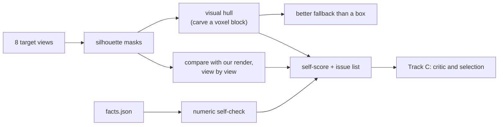

# Track B — See

**In plain words:** nobody gives us the answer file, so you build the instruments that
tell the agent whether a part is right: numbers from `facts.json`, and outlines from the
eight views. Everything you build is used twice: by the critic to fix a part, and by
the selector to pick the best candidate. This is the track for a 3D-vision background.

## You own

`forge/facts.py` `forge/render.py` `forge/geometry.py` `forge/stages/understand.py`
`forge/vision.py` (new, yours to create)

## Numbers you move

| Number | How to read it | Now | Target |
|---|---|---|---|
| Self-score vs leaderboard | rank correlation over our submissions | unmeasured | a higher self-score reliably means a higher leaderboard score |
| Silhouette agreement on a correct part | mean IoU over 8 views, our render of an answer vs its views | not built | above 0.98 |
| Fallback score | leaderboard with fallbacks only | box, about 0.3 | visual hull, 0.5 or more |

## Backlog, in order

1. **Silhouette masks from the target views.** Background is plain white; the part is
   tan with black outline strokes. Threshold, clean up, done. Check all 72 practice images.
2. **Match their framing.** To compare outlines, our render must frame the part as
   theirs does. Work out their rule from the practice views (the bounding box in
   `facts.json` gives real sizes): is each view fitted on its own, or is one scale used
   for all eight? Then make `forge/render.py` reproduce it, and render masks directly
   from triangles (the point-splat renderer is for model eyes, not for measurement).
3. **Silhouette IoU per view** between target mask and our mask. Add it to the
   self-check: per-view scores and a line per bad view ("top view: 0.71, extra material
   at lower left"). A difference image (red = missing, blue = extra) is the most useful
   thing a critic can be shown; make one sheet of eight.
4. **Visual hull.** Start from a voxel block of the facts' bounding box. For each of the
   six axis views, clear every voxel whose projection falls outside the silhouette; then
   the two isometric views. The result has the exact size and keeps every through-hole
   visible along an axis. Uses:
   - **pseudo-target**: score a candidate against the hull with `forge/score.py`
     (a correct part lies inside the hull and fills most of it);
   - **fallback**: turn the hull into one valid STEP solid and submit it when the agent
     fails. The slide says a convex shrink-wrap scores 0.51; a hull with holes should do
     better than that. Converting voxels or a mesh into a clean solid is the hard part:
     try extruding the axis silhouettes and intersecting the three prisms in CadQuery,
     which gives a B-rep directly;
   - **prior for the plan**: where is the mass, which views show holes.
5. **Holes from views.** Count enclosed background regions in each axis silhouette and
   compare with `through_holes_genus`. Tells the planner which holes go through, along
   which axis, and roughly where; the hole inventory in the facts gives exact diameters.
6. **Calibrate the self-score.** Once several submissions have leaderboard values,
   check which ingredients (volume ratio, area ratio, silhouette IoU, hull IoU) track
   it, and reweight `self_check`.
7. **Gap filling for complex parts.** Find what the brief leaves out (compare its
   feature list against the facts' face counts and hole inventory) and ask the model
   targeted questions about named views. Crop and enlarge the region first.
8. **Depth cues (speculative).** Shading in the views encodes surface orientation.
   Probably not worth the time; the outlines carry most of the signal.

## Search terms

silhouette extraction, shape from silhouette, visual hull, space carving, voxel carving,
orthographic projection, silhouette IoU, chamfer distance between contours, difference
image, rasterising triangles to a mask, connected components / hole counting in a binary
image, Euler number of a binary image, marching cubes, mesh to B-rep, sewing faces into
a solid (OpenCASCADE BRepBuilderAPI_Sewing), intersection of extruded profiles,
contour tracing to polyline, polygon simplification (Douglas–Peucker), analysis by
synthesis, render-and-compare, differentiable rendering.

## Traps

- Trusting volume and area alone. Two different shapes can share both.
- Comparing outlines with mismatched framing: every part will look wrong by a few pixels.
- A hull fallback that is not a single valid solid. That scores 0, worse than a box.
  Always validate with the backend and keep the box as the last resort.
- The isometric views: their exact camera angle is "from +X, -Y, +Z"; confirm it is the
  (1, -1, 1) diagonal before carving with them.

## Lab notes

Append one line per experiment: date, idea, number before → after, kept or dropped.
