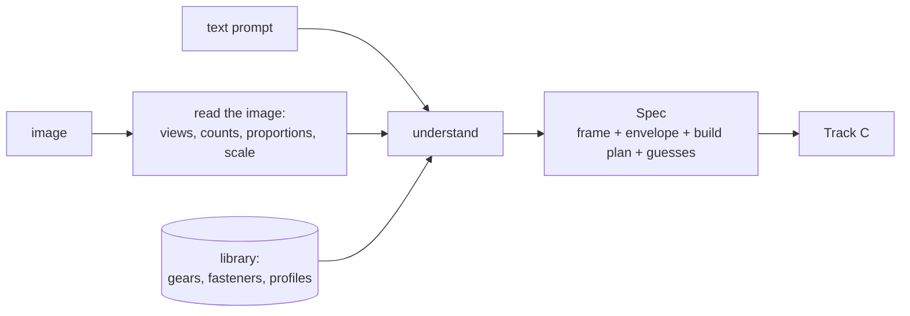

# Track B — Understand

**In plain words:** you turn what the organisers give us, a sentence or a picture, into
a precise brief that a code generator cannot misread. Writing a fully dimensioned prompt
is most of the work of modelling the part; the organisers will not do that for us, so
your stage does. You also own the shelf of ready-made standard parts.

## You own

`forge/stages/understand.py` `forge/library/`

## Numbers you move

| Number | How to read it | Now | Target |
|---|---|---|---|
| Image-input IoU | `forge eval --image` | unmeasured | within 0.10 of text-input |
| Envelope error | `ratios.extents_sorted` in `scores.json`, distance from 1.0 | unmeasured | under 5% on text, under 15% on image |
| Frame mistakes | cases where `rot24` IoU beats `raw` IoU by more than 0.2 | unmeasured | zero on text input |
| Library coverage | standard parts in tasks that have a helper | 1 helper | every standard part the examples contain |

To test your stage alone: run `forge solve`, open `spec.md`, compare it to the target's
`measure.json`. You do not need Track C to be good to know whether the brief is right.

## Backlog, in order

1. **Make the brief checkable.** Have the model emit, besides the prose, a small JSON
   block: units, up axis, origin convention, envelope `[x, y, z]`, and a feature list
   with type, size, position. Fill `Spec.envelope` and `Spec.notes`. Track C's critic can
   then compare kernel measurements against numbers, not against prose. Agree the field
   names with Track C before merging; this touches the shared contract.
2. **Frame conventions.** When a task does not state the frame, which default matches the
   targets most often? Measure it on Track A's benchmark and on the organisers' examples
   (compare target `bbox_min`/`bbox_max` patterns: centred, base on Z=0, corner at
   origin). Hard-code the winner into the prompt. Under a `raw` metric this is worth more
   than anything else you will do.
3. **Image reading as its own step.** One look is not enough. Try, and measure each:
   - describe each view separately, then reconcile into one part;
   - ask for *ratios* first (height to width, hole to plate), absolute size second;
   - count repeated features with a dedicated question per feature type;
   - crop and enlarge regions with small features and ask again;
   - read any dimension text or scale bar explicitly.
4. **Scale from an image.** A picture has no units. Options: dimension annotations if
   present; typical sizes for the part type; or accept it and rely on a `unit`-style
   metric. Decide after Track A reports which alignment the organisers use.
5. **Self-consistency of the brief.** Generate the brief three times; where they
   disagree is where the task is ambiguous. Either take the majority or pass the
   disagreement to Track C as alternative candidates.
6. **Grow the library on demand.** Add a helper only when a real task needs it.
   Candidates: hex bolt and nut by metric size, washer, simplified thread (plain
   cylinder at major diameter is usually enough under an overlap score), bevel or
   helical gear, standard structural profiles, keyway, counterbore and countersink.
   Every helper gets a test in `tests/`.
7. **Gear tooth count from an image.** Known weak spot. Try: crop the rim, count teeth
   in a quarter and multiply; ask for count, pitch estimate and diameter and check they
   agree; unwrap the rim to a strip before counting.
8. **Retrieval.** Instead of pasting the whole catalogue, retrieve the few helpers and
   the few worked example briefs most similar to the task.
9. **Pseudo-target from the image (speculative, high ceiling).** An image-to-3D model
   turns the picture into a rough mesh. That mesh is no CAD part, but it is something to
   *score candidates against at test time*, which we otherwise lack. Needs GPU and
   organiser permission; scope it with Track C before spending hours.

## Search terms

prompt expansion, query rewriting, design intent, intermediate representation for CAD,
structured output / JSON schema, chain-of-thought dimensioning, clarify-before-draw,
self-consistency, multi-view reasoning, orthographic projection, engineering drawing
understanding, GD&T reading, monocular scale ambiguity, visual hull, silhouette
matching, set-of-marks prompting, visual question answering for counting, crop-and-zoom,
retrieval-augmented generation, few-shot exemplar retrieval, parametric template,
feature recognition, image-to-3D reconstruction, single-view reconstruction.

Gears: module, pitch diameter, addendum, dedendum, pressure angle, involute function,
base circle, undercut, DIN 867 / ISO 53 basic rack, profile shift.

Papers to skim for how they get dimensions out of a picture: cadrille, CAD-Coder,
GIFT, Ortho2CAD, CADCodeVerify, BenchCAD (failure analysis section).

## Traps

- Inventing precision. If the task says "a small bracket", a brief with twelve confident
  dimensions is still a guess; mark guesses so Track C can vary them across candidates.
- Spending hours on tooth profiles or thread helixes. Overlap scores barely see them.
- A brief so long the code generator loses the envelope in the noise. Frame and
  envelope go first, always.

## Lab notes

Append one line per experiment: date, idea, score before → after, kept or dropped.
