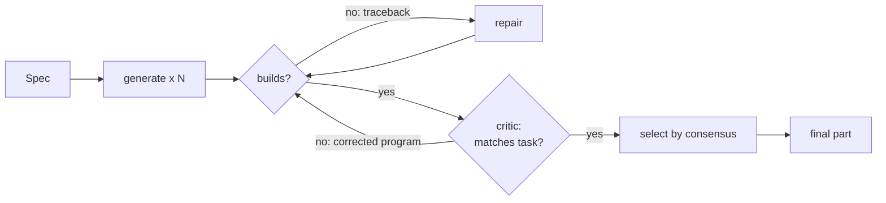

# Track C — Build

**In plain words:** given a clear brief, you produce a part that always builds, and you
make the agent catch its own mistakes before we submit. You also own the connection to
the CAD engine, which is the piece most likely to change at the briefing.

## You own

`forge/stages/build.py` `forge/stages/verify.py` `forge/stages/select.py` `forge/backends/`

## Numbers you move

| Number | How to read it | Now | Target |
|---|---|---|---|
| Build rate | share of cases with a usable part | unmeasured | 100% |
| Text-input IoU | `forge eval` | unmeasured | above 0.90 on our bench |
| Critic gain | final IoU minus first-runnable IoU (Track A backlog item 2) | unmeasured | positive on average, never negative by more than 0.02 |
| Selection regret | best candidate in hindsight minus chosen | unmeasured | under 0.02 |
| Cost per task | model calls and seconds | unmeasured | fits the organisers' limit |

To test your stages alone: hand-write a perfect brief for a case and feed it in. If the
part is still wrong, the fault is yours and not Track B's.

## Backlog, in order

1. **Port the backend** (first hours after the briefing, if the engine is not CadQuery).
   Subclass `CadBackend`: write the `guide`, write a runner that executes a program in a
   subprocess with a timeout and writes STEP, STL and `measure.json` with the same keys
   as `_cq_runner.py`. Register it in `forge/backends/__init__.py`. The tests in
   `tests/test_offline.py` show what must keep working.
2. **Build rate first.** Collect every traceback from an eval run, group them, and
   attack the largest group. Usual suspects: fillet or chamfer radius too large, face
   selectors that match nothing after an earlier operation, sweeps whose path does not
   start at the profile, lofts between incompatible sections, shells on filleted bodies.
   Fix each by a line in the guide, a worked example, or a fallback rule.
3. **Graceful degradation.** If repair is exhausted, strip the failing feature and keep
   the body. A part without its fillets scores about the same; a missing part scores zero.
   As a last resort return a box of the brief's envelope: that alone is worth ~0.4.
4. **Few-shot examples.** Add three to five short, correct programs to the generator
   prompt, covering revolve, sweep, loft, shell and polar patterns. Try static examples
   first, then retrieval of the most similar ones. Borrow only from cases Track A marks
   as not held out.
5. **A critic that disagrees.** The author model reviewing its own code tends to approve.
   Try: a different model as critic; a critic that never sees the program, only the task,
   measurements and renders; a checklist it must fill with numbers before it may approve.
6. **Numeric checks without a model.** Once Track B emits a structured brief, compare
   `measure.json` against it in plain Python: envelope within tolerance, hole count and
   radii from the cylinder list, volume plausible. Feed only the failed checks to the
   critic. Cheap, deterministic, and it never approves a wrong bounding box.
7. **Better views.** Show the input image next to the render for image tasks. Add a
   section view for parts with internal features. Let the critic ask for a zoomed view.
8. **Diversity before voting.** Three samples of one prompt are near copies. Vary the
   construction strategy (extrude-and-cut vs revolve vs union of primitives), vary
   Track B's flagged guesses, or vary the model. Consensus only means something when the
   voters are independent.
9. **Selection.** Compare the medoid against: critic score, numeric-check pass count,
   agreement with a pseudo-target if Track B builds one. Measure by selection regret.
10. **Parameter fitting (speculative).** When the structure is right and the numbers are
    off, expose the dimensions as variables and fit them with a derivative-free optimiser
    against whatever target signal we have (input-image silhouette, pseudo-target mesh).
11. **Edit tasks** (only if the organisers confirm them). `Task.base_code` carries the
    existing program; add a stage that modifies it and checks that untouched features
    stay put by comparing against the previous part outside the edited region.

## Search terms

LLM program synthesis, CAD code generation, CadQuery, build123d, OpenSCAD, FreeCAD
Python API, constructive solid geometry, feature-based / history-based modelling,
sketch-and-extrude, execution-guided generation, self-repair, self-debugging,
reflexion, visual feedback loop, critic / judge model, self-confirmation bias,
LLM-as-judge, self-consistency, best-of-N sampling, minimum Bayes risk decoding,
medoid selection, analysis-by-synthesis, inverse CAD, derivative-free optimisation
(CMA-ES, Nelder–Mead), few-shot exemplar retrieval, RAG over API documentation,
tool-use agent loop, OpenCASCADE BRepCheck, sewing, shape healing.

Papers: CADSmith (closest to our design; read its validator section), CADCodeVerify,
3D-PreMise, Text-to-CadQuery, CAD-Recode, "From Idea to CAD" multi-agent, CADTests,
BenchCAD Code Edit task.

## Traps

- A critic round that makes a good part worse. Always keep the previous version and
  measure critic gain per round; if round two is negative on average, cut it.
- Spending the budget on fillets and chamfers. Check the floors table: edge treatments
  are worth a percent or two.
- Selectors like `faces(">Z")` in generated code. They are the top source of silent
  wrong-face bugs; prefer explicit coordinates and boolean cuts.
- Prompt changes verified on two cases. Run at least the smoke subset.

## Lab notes

Append one line per experiment: date, idea, score before → after, kept or dropped.
