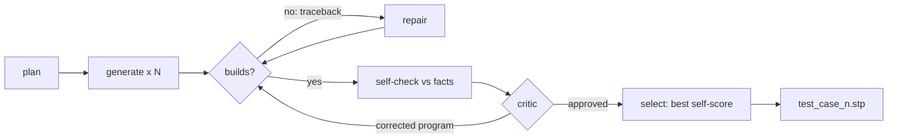

# Track C — Build

**In plain words:** you make the model write a program that builds the part, and fix it
when the checks say it is wrong. The brief gives exact numbers and Track B gives exact
checks, so your work is turning those into geometry that builds every time: first the
right size and every through-hole, then the masses, then detail.

## You own

`forge/stages/build.py` `forge/stages/verify.py` `forge/stages/select.py`
`forge/backends/` `forge/library/`

## Numbers you move

| Number | How to read it | Now | Target |
|---|---|---|---|
| Build rate | parts where the agent, not the fallback, produced the file | unmeasured | 9 of 9 |
| Dimension score | `self_check.dimensions`, exact | unmeasured | 1.00 on every part |
| Hole score | `self_check.holes`, exact | unmeasured | 1.00 on every part |
| Self-score by tier | simple / medium / complex means | unmeasured | simple ≥ 0.95, medium ≥ 0.85, complex ≥ 0.70 |
| Critic gain | self-score after critique minus before | unmeasured | positive on average |

To test your stages alone: write the plan by hand for one part and feed it in.

## Backlog, in order

1. **Run the base agent on the nine practice parts** and sort the outcomes: crashed,
   wrong size, wrong hole count, wrong shape. Everything below is ordered by a guess;
   reorder it by what you see.
2. **Exact envelope, always.** The bounding box is given. After building, if an extent
   is off by a hair, find the feature that sets it. Never rescale the finished part to
   fit: that distorts every hole.
3. **Hole count is a hard target.** `through_holes_genus` is the exact number the scorer
   counts. Typical ways to get it wrong: a blind hole drilled too deep becomes a through
   hole; two crossing bores merge; a hole that misses the body does nothing. Make the
   repair prompt name the difference ("built 5, target 6") and list the facts' hole
   inventory (diameter, axis, centre) so the model can find the missing one.
4. **Use the hole inventory directly.** `cylindrical_holes_and_bores` gives diameter,
   axis, length and centres. Generate those cuts from the data in plain Python and hand
   the model a part that already has its listed holes; let it spend its effort on the
   body. Mind `more_not_listed` and tilted axes given as vectors.
5. **Build rate.** Group tracebacks from a run and remove the largest group with a line
   in the guide, a worked example or a fallback rule. Usual suspects: fillet radius too
   large, selectors that match nothing, sweeps and lofts, shells on filleted bodies.
6. **Degrade, do not fail.** If repair runs out, drop the failing feature and keep the
   body. Fillets and chamfers go first: the simple and medium parts carry dozens of
   torus and cone faces that are worth almost nothing in volume.
7. **Part-type recipes.** The practice set is engine parts, and so is the hidden set.
   Give the generator short worked examples for the recurring kinds: revolved parts
   (valve, bushing: sketch the half profile, revolve), prismatic blocks with hole
   patterns (cylinder head), shafts with offset journals (crankshaft), bores on tilted
   axes (V-block: build the tool cylinder along Z, rotate, translate, cut), radial fin
   patterns. Do not copy the practice parts' numbers.
8. **Critic that uses Track B's instruments.** Feed it the per-view silhouette scores
   and the difference sheet once they exist. Try a critic that never sees the program.
9. **Budget by tier.** `faces` in the facts gives the tier. One candidate and no critic
   may be enough for a 12-face part; spend the saved minutes on the 600-face one.
10. **Candidate diversity.** Vary the construction strategy across candidates (revolve
    vs extrude-and-cut vs union of blocks) so that selection has real alternatives.
11. **Parameter fitting (speculative).** When the structure is right and volume is off
    by a few percent, expose the unspecified dimensions as variables and search them
    against the self-score.
12. **build123d backend (optional).** Same kernel, different API. Worth an hour only if
    CadQuery's failure groups look API-specific.

## Search terms

CadQuery revolve / sweep / loft / shell, CadQuery polarArray and rarray, cut along
arbitrary axis, Workplane transformed rotate offset, counterbore and countersink
(cboreHole, cskHole), OpenCASCADE fillet failure, BRepCheck, shape healing, LLM program
synthesis for CAD, execution-guided generation, self-repair, critic model,
self-confirmation bias, best-of-N with a verifier, few-shot exemplar retrieval,
feature-based modelling, design intent, constructive solid geometry, derivative-free
optimisation (Nelder–Mead, CMA-ES), build123d.

Papers: CADSmith (numeric validator section), CADCodeVerify, ToolCAD (engine text
feedback beats visual feedback on multi-part models), Text2CAD-Bench (why sweep, loft
and shell crash).

## Traps

- Mirroring. The scorer does not mirror; a left-handed part scores like a different part.
  Check asymmetric features against the views.
- A critic round that lowers the self-score. `verify.py` reverts those; keep it that way.
- Spending the time budget on edge treatments while a hole is missing.
- Tuning prompts to the nine practice parts. The hidden parts are different parts of the
  same kind.

## Lab notes

Append one line per experiment: date, idea, number before → after, kept or dropped.

- 11 Nov (branch `c/facts-driven`): bores cut from facts + fitted `# FIT` dimensions + truncated-reply fix: parts built 3 → 4 as written, 7 with candidates on disk; hand-picked set scores 0.658 on the leaderboard. Kept, not merged.
- 11 Nov: fitting ran the kernel up to 64 times per candidate and can hide shape errors (part 5). Cap it and run it once, on the chosen candidate.
