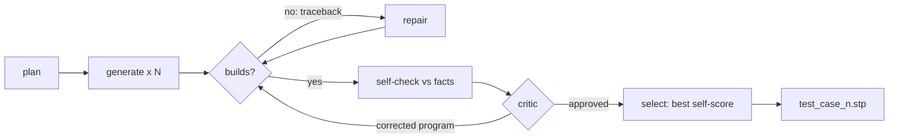

# Track C — Build

**In plain words:** you make the model write a program that builds the part, and fix it
when the checks say it is wrong. The brief gives exact numbers and Track B gives exact
checks, so your work is turning those into geometry that builds every time: first the
right size and every through-hole, then the masses, then detail.

## You own

`forge/stages/build.py` `forge/stages/verify.py` `forge/stages/select.py`
`forge/backends/` `forge/library/`

## Numbers you move

| Number | How to read it | Now | Target |
|---|---|---|---|
| Build rate | parts where the agent, not the fallback, produced the file | unmeasured | 9 of 9 |
| Dimension score | `self_check.dimensions`, exact | unmeasured | 1.00 on every part |
| Hole score | `self_check.holes`, exact | unmeasured | 1.00 on every part |
| Self-score by tier | simple / medium / complex means | unmeasured | simple ≥ 0.95, medium ≥ 0.85, complex ≥ 0.70 |
| Critic gain | self-score after critique minus before | unmeasured | positive on average |

To test your stages alone: write the plan by hand for one part and feed it in.

## Backlog, in order

1. **Run the base agent on the nine practice parts** and sort the outcomes: crashed,
   wrong size, wrong hole count, wrong shape. Everything below is ordered by a guess;
   reorder it by what you see.
2. **Exact envelope, always.** The bounding box is given. After building, if an extent
   is off by a hair, find the feature that sets it. Never rescale the finished part to
   fit: that distorts every hole.
3. **Hole count is a hard target.** `through_holes_genus` is the exact number the scorer
   counts. Typical ways to get it wrong: a blind hole drilled too deep becomes a through
   hole; two crossing bores merge; a hole that misses the body does nothing. Make the
   repair prompt name the difference ("built 5, target 6") and list the facts' hole
   inventory (diameter, axis, centre) so the model can find the missing one.
4. **Use the hole inventory directly.** `cylindrical_holes_and_bores` gives diameter,
   axis, length and centres. Generate those cuts from the data in plain Python and hand
   the model a part that already has its listed holes; let it spend its effort on the
   body. Mind `more_not_listed` and tilted axes given as vectors.
5. **Build rate.** Group tracebacks from a run and remove the largest group with a line
   in the guide, a worked example or a fallback rule. Usual suspects: fillet radius too
   large, selectors that match nothing, sweeps and lofts, shells on filleted bodies.
6. **Degrade, do not fail.** If repair runs out, drop the failing feature and keep the
   body. Fillets and chamfers go first: the simple and medium parts carry dozens of
   torus and cone faces that are worth almost nothing in volume.
7. **Part-type recipes.** The practice set is engine parts, and so is the hidden set.
   Give the generator short worked examples for the recurring kinds: revolved parts
   (valve, bushing: sketch the half profile, revolve), prismatic blocks with hole
   patterns (cylinder head), shafts with offset journals (crankshaft), bores on tilted
   axes (V-block: build the tool cylinder along Z, rotate, translate, cut), radial fin
   patterns. Do not copy the practice parts' numbers.
8. **Critic that uses Track B's instruments.** Feed it the per-view silhouette scores
   and the difference sheet once they exist. Try a critic that never sees the program.
9. **Budget by tier.** `faces` in the facts gives the tier. One candidate and no critic
   may be enough for a 12-face part; spend the saved minutes on the 600-face one.
10. **Candidate diversity.** Vary the construction strategy across candidates (revolve
    vs extrude-and-cut vs union of blocks) so that selection has real alternatives.
11. **Parameter fitting (speculative).** When the structure is right and volume is off
    by a few percent, expose the unspecified dimensions as variables and search them
    against the self-score.
12. **build123d backend (optional).** Same kernel, different API. Worth an hour only if
    CadQuery's failure groups look API-specific.

## Search terms

CadQuery revolve / sweep / loft / shell, CadQuery polarArray and rarray, cut along
arbitrary axis, Workplane transformed rotate offset, counterbore and countersink
(cboreHole, cskHole), OpenCASCADE fillet failure, BRepCheck, shape healing, LLM program
synthesis for CAD, execution-guided generation, self-repair, critic model,
self-confirmation bias, best-of-N with a verifier, few-shot exemplar retrieval,
feature-based modelling, design intent, constructive solid geometry, derivative-free
optimisation (Nelder–Mead, CMA-ES), build123d.

Papers: CADSmith (numeric validator section), CADCodeVerify, ToolCAD (engine text
feedback beats visual feedback on multi-part models), Text2CAD-Bench (why sweep, loft
and shell crash).

## Traps

- Mirroring. The scorer does not mirror; a left-handed part scores like a different part.
  Check asymmetric features against the views.
- A critic round that lowers the self-score. `verify.py` reverts those; keep it that way.
- Spending the time budget on edge treatments while a hole is missing.
- Tuning prompts to the nine practice parts. The hidden parts are different parts of the
  same kind.

## Lab notes

Append one line per experiment: date, idea, number before → after, kept or dropped.

- 11 Nov (branch `c/facts-driven`): bores cut from facts + fitted `# FIT` dimensions + truncated-reply fix: parts built 3 → 4 as written, 7 with candidates on disk; hand-picked set scores 0.658 on the leaderboard. Kept, not merged.
- 11 Nov: fitting ran the kernel up to 64 times per candidate and can hide shape errors (part 5). Cap it and run it once, on the chosen candidate.
- 12 Nov: bores cut from the facts pattern by pattern until the through-hole count matches (`forge/compile.py: cut_holes_to_genus`): holes 1.00 on 9 of 9 with no model (before: 7 of 9 built at all). Kept.
- 12 Nov: hole count from B-rep topology (`brep_genus`) instead of meshing: same answer on 107 files, pass 1 from 19 min to 6 min. Kept.
- 12 Nov: model writes the body only, trimmed by the hull, bores by code: beats the no-model part on parts 4 and 6 only (thinking off), on 7 parts by small margins (thinking on). Kept as pass 2.
- 12 Nov: model lists empty regions as boxes and cylinders, code cuts and checks each (`forge/stages/carve.py`): most proposals rejected (silhouette changed, hole count changed, volume too low); part 4 0.825 → 0.851. Kept behind `FORGE_CARVE=1`; placement of an accepted cut is not verified.
- 12 Nov: today's tasks are C1–C5 in `docs/PLAN.md`.
- 12 Nov, leaderboard: model bodies help (part 4 0.851 → 0.915, part 1 +0.03, part 6 +0.01), model cut lists do not (part 9 0.784 → 0.733, part 8 −0.006, part 5 0, part 2 +0.014). Run with `FORGE_CARVE=0`.
- 12 Nov, review of 54 model-written bodies (runs `two-pass-1`, `-2`, `-4`): 12 ran at the first try (22%); of 80 errors 47 are CadQuery API misuse (methods that do not exist, wrong arguments to `center`, `rect`, `translate`, `transformed`), 21 kernel failures (fillet, loft, wire), 4 several solids. Of the 17 bodies that ran in the two thinking-on runs, 8 had the wrong envelope; the code shows why: `box()` is centred by default while features are placed in 0..X coordinates, and `Workplane("XZ").center()` is given world coordinates. The bodies that scored (parts 1, 2, 4) use only primitives placed by absolute coordinates and unioned. A body that runs with a wrong envelope is never sent back for repair. Next: a small helper API in absolute coordinates (box between corners, cylinder between two points, extruded polygon along an axis, revolved profile) so the model writes calls, not CadQuery; and envelope errors fed back as a repair.
- 12 Nov: model bodies written with helper solids in absolute coordinates + envelope repair (`c/helper-api`). Bodies that run at the first try: 22% → 90% (thinking off, 19 of 21) and 100% (thinking on, 14 of 14); errors 80 → 2; envelope right in the end 9 of 17 → 35 of 35 (12 of them after one repair). Model pass with thinking off takes about 70 s for nine parts. The bodies now build but are mostly worse than the hull on parts 5, 7, 8, 9 (estimate 0.1–0.6): what is left is spatial, not syntax. Leaderboard for `02` (old prompt, thinking off): part 4 0.913, so thinking is not needed for that gain.
- 12 Nov, leaderboard for `09` (helper-API bodies, thinking on, cut lists): 0.863 against 0.870 for `05` and 0.856 for the no-model floor. Bodies: part 4 +0.063, 6 +0.034, 5 +0.019, 7 −0.026 against the floor; cut lists: part 2 −0.023, part 8 −0.007. Build rate is no longer the problem; placement inside the outline is, and the estimate cannot see it (it promised +0.36 over six parts, the leaderboard gave +0.06). Cut lists off from here on.
- 12 Nov, leaderboard for `10` (clean configuration, thinking-off helper bodies, no cut lists): 0.862. Against the no-model floor: part 4 +0.063, part 6 +0.052 (0.662, the best seen), part 7 −0.060. One wrong model body on part 7 cost as much as the gain on part 6.
- 12 Nov: volume budget in the body prompt + volume repair (a body more than 10% off the target volume goes back with the figures). Qwen3.8-27B, thinking off: simple parts land on the volume (part 2: x0.89 → x1.02, x0.19 → x1.03); on complex parts it thrashes (part 9: x0.73 → x1.64 → x0.68) or hits the volume by wrecking the shape (part 6: x2.64 → x1.03 with silhouette IoU 0.93 → 0.54). The better version is always the one kept, so it costs calls (about 60 s per run), not points. No measurable gain with this model; kept for the bigger-model test.
- 12 Nov (branch `c/shell-fit`): thin-walled shell body source (`forge/compile.py: shell_bodies`): fires when the outline body has > x1.3 the facts' volume and less surface; wall solved from the facts' volume; closed or one/two largest bbox faces open (openings by booleans, OCC's open-shell offset fails on hull bodies); exact estimate ties broken by surface (`rank_key`). True local score, 12 reference parts: 0.9236 → 0.9485 (enclosure 0.679 → 0.978, no other part changed). Practice estimate: part 6 0.516 → 0.911, mean 0.808 → 0.845; pass-1 wall 571 s on 16 CPUs. Open variants hit the 120 s cap on practice parts 6, 7, 9. Kept, not on the leaderboard yet.
- 12 Nov (branch `c/star-fins`): star step (`forge/compile.py: star_bodies`, code written by Qwen3.5-27B on the box and reviewed): a turned body whose axis view (or the opposite one) repeats n-fold gets n V-grooves on its tapered section; fin count = largest multiple of `rotation_order` that still matches; groove depth chosen by the edge score. True local score on five new reference parts: pleated hollow cone 0.680 → 0.759, odd pleats wider at the top 0.676 → 0.751, solid 24-pleat cone 0.984 (not hollowed), smooth hollow cone and star knob unchanged. Round hull shells are skipped when a star body exists (on the pleated cone the round shell scored 0.615 true while the estimate gave it 0.914; the leaderboard of 16 showed the same on part 6: 0.600). Hollowing the star body (FORGE_STAR_SHELL=on) costs about a minute per wall tried and is off. Practice estimate: part 6 0.516 → 0.605, mean 0.808 → 0.817; full run 1684 s on the box.
- 12 Nov, late (branch `c/fingerprint`, Ideas B and C): new tool `handoff/rank_bench.py` true-scores EVERY candidate row of the reference parts, `handoff/rank_eval.py` compares ranking rules offline. 17 parts, shells on: oracle 0.9108, estimate alone 0.9107; + surface penalty or + two-number term (C) 0.9107 (no change); + face-type fingerprint (B1) 0.900 to 0.842 (worse at every weight: faceted hulls look "far" from any fact inventory). Ranking is not where the points are on these parts. B2 (groove count from PLANE count) does not hold (24 pleats -> 4 planes, 9 pleats -> 49). Partial shell (hollow only the tapered middle of a turned part, cavity = middle scaled toward the axis, k from the volume in closed form): 17_smooth_hollow_cone 0.723 -> 0.792, but chosen wrongly on 15_odd_pleats 0.752 -> 0.640, 18_solid_end_pleats 0.766 -> 0.753; the star-body version crashes or hangs in the kernel. Kept behind FORGE_PARTSHELL=on, off by default. Part 6's face counts (4 TORUS, 6 CYLINDER, seams splitting each round in halves) fit solid end discs better than a uniform shell. Baseline main settings (shells off) 0.8892 on 17 parts.
